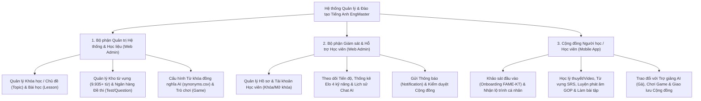
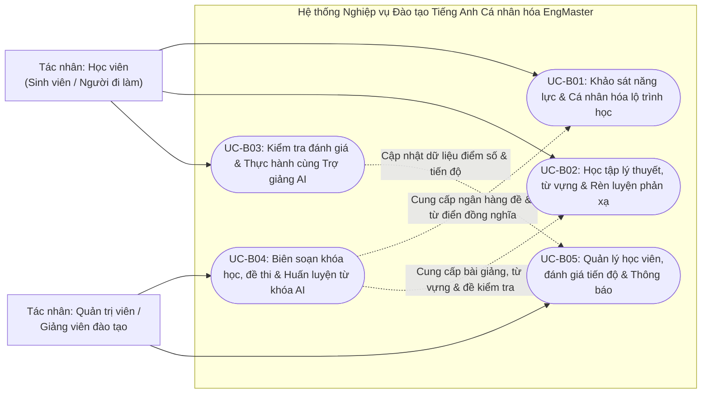
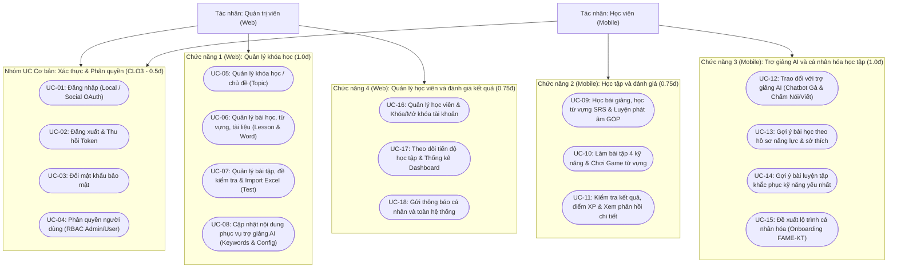

# TÀI LIỆU KHÓA LUẬN CỬ NHÂN (MỞ ĐẦU, CHƯƠNG 1, CHƯƠNG 2 & TRÍCH DẪN BÁO CHÍ VIỆT NAM)
**Đề tài:** XÂY DỰNG ỨNG DỤNG HỌC TIẾNG ANH (Hệ thống EngMaster)  
**Trường:** Đại học Công Thương TP. Hồ Chí Minh (HUIT) – Khoa Công nghệ Thông tin  
**Giảng viên hướng dẫn:** Đinh Thị Tâm  
**Sinh viên thực hiện:**
1. 2001230991 – Đào Thanh Trọng – 14DHTH08
2. 2001230739 – Lê Cường Quốc – 14DHTH08
3. 2001230750 – Võ Nguyễn Khánh Quỳnh – 14DHTH08

---

## PHẦN I: TỔNG HỢP NGUỒN BÁO CHÍ VIỆT NAM, VỊ TRÍ ĐOẠN CHỨA SỐ LIỆU VÀ TRÍCH DẪN NGUYÊN VĂN

> **Hướng dẫn kiểm chứng:** Tất cả các liên kết dưới đây đều là đường dẫn trực tiếp đến các tờ báo chính thống tại Việt Nam (*Tuổi Trẻ, VnExpress, VTV, VnEconomy*). Mỗi nguồn đều ghi rõ **số liệu nằm ở đoạn thứ mấy trong bài báo** và **trích dẫn nguyên văn câu chữ** để nhóm dễ dàng đối chiếu và bảo vệ trước Hội đồng.

### Nguồn [1]: Báo Tuổi Trẻ Online – Báo cáo Chỉ số thông thạo tiếng Anh EF EPI 2025
- **Tiêu đề bài báo:** Việt Nam cải thiện chỉ số thông thạo tiếng Anh, bám sát nhóm dẫn đầu khu vực
- **Ngày đăng:** 19/11/2025
- **Đường dẫn bấm trực tiếp:** [https://tuoitre.vn/viet-nam-cai-thi-nh-chi-so-thong-thao-tieng-anh-bam-sat-nhom-dan-dau-khu-vuc-20251119173255146.htm](https://tuoitre.vn/viet-nam-cai-thi-nh-chi-so-thong-thao-tieng-anh-bam-sat-nhom-dan-dau-khu-vuc-20251119173255146.htm)
- **Vị trí đoạn văn và trích dẫn nguyên văn chứa số liệu:**
  + **Đoạn 1:** *"Trong báo cáo Chỉ số thông thạo Anh ngữ EF 2025 công bố tại TP.HCM ngày 19-11, Việt Nam tiếp tục cải thiện điểm số và củng cố vị trí trong nhóm quốc gia có năng lực tiếng Anh trung bình của châu Á."*
  + **Đoạn 2 (Số liệu hạng 64 thế giới, 500 điểm, hạng 7/25 châu Á):** *"Theo EF EPI 2025, Việt Nam xếp thứ 64 thế giới với 500 điểm, tăng so với 498 điểm của năm trước. Trong khu vực châu Á, Việt Nam đứng thứ 7/25 quốc gia, vượt Indonesia (471 điểm), Trung Quốc (464 điểm), Lào (461 điểm) và Campuchia (390 điểm)."*
  + **Đoạn 3 (Số liệu so sánh với Malaysia và Philippines):** *"Việt Nam hiện chỉ còn cách nhóm dẫn đầu, Malaysia (581 điểm) và Philippines (569 điểm). Khoảng cách này được nhận định là "thu hẹp đáng kể" so với 5 năm trước."*
  + **Đoạn 4 & Đoạn 5 (Số liệu phân bổ theo các thành phố lớn tại Việt Nam):** *"Với chỉ số riêng về các khu vực trong nước, Hà Nội tiếp tục giữ vững vị trí số một cả nước với 532 điểm, theo sau là Nha Trang (517 điểm) và Đà Nẵng (509 điểm). Hai đô thị lớn là TP.HCM (508 điểm) và Hải Phòng (506 điểm) đều nằm trong nhóm khá, cho thấy chất lượng tiếng Anh đang phân bố ngày càng đồng đều thay vì dồn vào một vài địa phương trọng điểm."*
  + **Đoạn 6 (Số liệu nhóm độ tuổi lao động trẻ 26–30 tuổi):** *"Đáng chú ý, lực lượng lao động trẻ từ 26-30 tuổi đạt điểm trung bình 544 điểm, cao nhất trong tất cả nhóm tuổi, cho thấy thế hệ mới đang tự tin hơn và sẵn sàng hội nhập sâu vào thị trường lao động toàn cầu."*

---

### Nguồn [2]: Báo Tuổi Trẻ Online – Báo cáo Chỉ số thông thạo tiếng Anh EF EPI 2024
- **Tiêu đề bài báo:** Chỉ số thông thạo tiếng Anh: Việt Nam đứng thứ 63 trong 116 quốc gia khảo sát
- **Ngày đăng:** 13/11/2024
- **Đường dẫn bấm trực tiếp:** [https://tuoitre.vn/chi-so-thong-thao-tieng-anh-viet-nam-dung-thu-63-trong-116-quoc-gia-khao-sat-20241112224749303.htm](https://tuoitre.vn/chi-so-thong-thao-tieng-anh-viet-nam-dung-thu-63-trong-116-quoc-gia-khao-sat-20241112224749303.htm)
- **Vị trí đoạn văn và trích dẫn nguyên văn chứa số liệu:**
  + **Đoạn 3 (Quy mô khảo sát 2,1 triệu người tại 116 quốc gia):** *"Chỉ số EPI năm 2024 được phân tích từ kết quả kiểm tra của 2,1 triệu người không phải người bản ngữ nói tiếng Anh từ 18 tuổi trở lên tại 116 quốc gia và khu vực."*
  + **Đoạn 4 (Thang điểm phân nhóm năng lực EPI):** *"Dựa trên kết quả chỉ số EPI, các quốc gia sẽ được chia thành các nhóm thành thạo tiếng Anh: Rất cao (trên 600 điểm), Cao (550 - 599 điểm), Trung bình (500 - 549 điểm), Thấp (450 - 499 điểm), Rất thấp (dưới 450 điểm)."*
  + **Đoạn 5, Đoạn 6 & Đoạn 7 (Số liệu Việt Nam đạt 498 điểm, hạng 63/116):** *"Năm 2024, chỉ số thông thạo về trình độ tiếng Anh của người Việt Nam đạt 498 điểm, nằm ở nhóm thấp. Một năm trước, năm 2023, Việt Nam đạt 505 điểm, nằm trong nhóm trung bình. Trong bảng xếp hạng toàn cầu năm nay, Việt Nam đứng thứ 63 trên tổng số 116 quốc gia và khu vực. Như vậy, thứ hạng năm 2024 của Việt Nam đã giảm 5 bậc so với một năm trước đó, từ 58 xuống 63..."*

---

### Nguồn [3]: Báo Tuổi Trẻ Online – Thống kê điểm thi IELTS của người Việt (Minh chứng kỹ năng Speaking thấp nhất)
- **Tiêu đề bài báo:** Điểm thi IELTS phổ biến nhất của thí sinh Việt Nam là 6.0
- **Ngày đăng:** 14/10/2024
- **Đường dẫn bấm trực tiếp:** [https://tuoitre.vn/diem-thi-ielts-phu-bien-nhat-cua-thi-sinh-viet-nam-la-6-0-20241014223403565.htm](https://tuoitre.vn/diem-thi-ielts-phu-bien-nhat-cua-thi-sinh-viet-nam-la-6-0-20241014223403565.htm)
- **Vị trí đoạn văn và trích dẫn nguyên văn chứa số liệu:**
  + **Sa-bô (Đoạn mở đầu):** *"Thống kê từ IELTS cho thấy điểm thi phổ biến nhất của thí sinh Việt Nam là 6.0, trong khi đó chỉ 1% thí sinh đạt trên điểm 8.5."*
  + **Đoạn 1 & Đoạn 2 (Điểm trung bình 6.2/9.0, hạng 29/39 quốc gia):** *"Theo thống kê mới nhất do IELTS công bố, trong năm 2023-2024, điểm trung bình của thí sinh Việt Nam trong kỳ thi IELTS (Academic) đạt 6.2. Điểm số này tương đồng với điểm IELTS trung bình của thí sinh Việt Nam trong năm 2022, cũng là 6.2 trên tổng điểm 9.0. Tuy nhiên nếu xét về thứ hạng, vị trí của Việt Nam có sự thay đổi. Cụ thể với điểm số 6.2, thành tích thi IELTS (Academic) mới nhất của thí sinh Việt Nam xếp hạng 29 trong tổng số 39 quốc gia và vùng lãnh thổ được khảo sát."*
  + **Đoạn 3 (Tỷ lệ phân bố mức điểm của thí sinh Việt Nam):** *"Trong các mức điểm, thí sinh Việt Nam đạt được nhiều nhất là điểm IELTS (Academic) 6.0, chiếm khoảng 21% tổng số thí sinh. Tiếp đó, 18% thí sinh đạt điểm 6.5 và cũng 18% đạt điểm 5.5. Chỉ 1% đạt mức cao từ 8.5 trở lên."*
  + **Đoạn 4 (Điểm thành phần 4 kỹ năng: Listening 6.3, Reading 6.4, Writing 6.0, Speaking thấp nhất 5.7):** *"Về điểm số thành phần, thí sinh Việt Nam đạt 6.3 ở bài thi Listening (Nghe), 6.4 ở bài thi Reading (Đọc), 6.0 ở bài thi Writing (Viết) và 5.7 ở bài thi Speaking (Nói). So với năm 2022, điểm số IELTS của thí sinh Việt Nam ở kỹ năng Listening và Speaking giảm nhẹ 0.1 điểm, trong khi điểm số ở kỹ năng Reading và Writing vẫn giữ nguyên."*

---

### Nguồn [4]: Báo điện tử VnExpress – Thống kê điểm IELTS và TOEFL iBT của người Việt
- **Tiêu đề bài báo:** Điểm thi IELTS trung bình của người Việt là 6.2
- **Đường dẫn bấm trực tiếp:** [https://vnexpress.net/diem-thi-ielts-trung-binh-cua-nguoi-viet-la-6-2-4649126.html](https://vnexpress.net/diem-thi-ielts-trung-binh-cua-nguoi-viet-la-6-2-4649126.html)
- **Vị trí đoạn văn và trích dẫn nguyên văn chứa số liệu:**
  + **Đoạn 2 (Tỷ lệ mục đích thi Academic 80%):** *"Báo cáo "Dữ liệu điểm thí sinh IELTS toàn cầu 2022" cho biết hơn 80% thí sinh chọn làm bài thi Academic (Học thuật) - dành cho mục đích vào đại học và sau đại học. Số còn lại làm bài thi General Training (Tổng quát), dành cho mục đích học nghề và định cư. Điểm trung bình của các thí sinh nữ là 6.28 trên thang 9, thí sinh nam đạt 6.22."*
  + **Đoạn 4 (So sánh 4 kỹ năng của người Việt với trung bình thế giới):** *"Việt Nam xếp thứ 23 với điểm trung bình của các thí sinh là 6.2 IELTS, đồng hạng với Hàn Quốc, Ấn Độ và Pakistan. Trong đó, điểm từng kỹ năng của người Việt là Nghe 6.4, Đọc 6.4, Viết 6.0, Nói 5.8. So với trung bình của thế giới, người Việt có kết quả bài thi Đọc và Viết cao hơn, nhưng Nghe và Nói thấp hơn."*
  + **Đoạn 9 (Số liệu TOEFL iBT của ETS: Đọc 22/30 nhưng Nói chỉ đạt 14/30):** *"Theo công bố của Viện Khảo thí Giáo dục Mỹ (ETS), đơn vị tổ chức thi TOEFL iBT, điểm trung bình bài thi TOEFL iBT trên toàn thế giới là 88/120... Người Việt xếp thứ 24 trên 30 quốc gia và vùng lãnh thổ ở châu Á được ETS thống kê, với điểm trung bình là 77. Thí sinh Việt Nam đạt điểm Đọc tốt nhất - 22/30 điểm, kém nhất ở kỹ năng Nói với 14/30 điểm."*

---

### Nguồn [5]: Báo điện tử VnExpress – Thực trạng 4 rào cản tự học tiếng Anh tại Việt Nam
- **Tiêu đề bài báo:** Bốn trở ngại của người đi làm muốn học tiếng Anh
- **Đường dẫn bấm trực tiếp:** [https://vnexpress.net/bon-tro-ngai-cua-nguoi-di-lam-muon-hoc-tieng-anh-4261234.html](https://vnexpress.net/bon-tro-ngai-cua-nguoi-di-lam-muon-hoc-tieng-anh-4261234.html)
- **Vị trí đoạn văn và trích dẫn nguyên văn chứa số liệu:**
  + **Đoạn 1 (Mở đầu - Thực trạng học cấp tốc thiếu lộ trình):** *"Nhiều người khi có nhu cầu chuyển việc lương cao mới vội vàng đến các lớp tiếng Anh để học và yêu cầu giao tiếp thành thạo trong một tháng."*
  + **Đoạn 2 (Trở ngại 1 - Mục tiêu mơ hồ & định lượng từ vựng CEFR: A1 500 từ, A2 1.000 từ, B1 2.000 từ):** *"1. Mục tiêu không rõ ràng, cả thèm chóng chán."* (Đoạn văn phân tích người học chỉ đặt mục tiêu chung chung là giao tiếp được mà không biết chuẩn số lượng từ vựng theo khung tham chiếu châu Âu CEFR cần đạt như A1 cần 500 từ, A2 cần 1.000 từ, B1 cần 2.000 từ...).
  + **Đoạn 3 (Trở ngại 2 - Hạn chế quỹ thời gian):** *"2. Hạn chế về thời gian. Việc vừa đi làm vừa đi học sẽ khiến bạn gặp khó khăn trong việc sắp xếp thời gian tham gia học cũng như làm bài tập đầy đủ."*
  + **Đoạn 4 (Trở ngại 3 - Tâm lý ngại phát âm):** *"3. Lười và ngại nói"*
  + **Đoạn 5 (Trở ngại 4 - Thiếu môi trường thực hành phản xạ):** *"4. Thiếu môi trường thực hành."*

---

### Nguồn [6]: Thời báo VTV (Đài Truyền hình Việt Nam) – Quy mô thị trường EdTech và Giáo dục trực tuyến Việt Nam
- **Tiêu đề bài báo:** Việt Nam nằm trong top 10 thị trường EdTech thế giới
- **Ngày đăng:** 19/08/2025
- **Đường dẫn bấm trực tiếp:** [https://vtv.vn/viet-nam-nam-trong-top-10-thi-truong-edtech-the-gioi-20250819124233767.htm](https://vtv.vn/viet-nam-nam-trong-top-10-thi-truong-edtech-the-gioi-20250819124233767.htm)
- **Vị trí đoạn văn và trích dẫn nguyên văn chứa số liệu:**
  + **Đoạn 1 (Quy mô EdTech toàn cầu):** *"Thị trường công nghệ giáo dục (EdTech) toàn cầu đang chứng kiến sự tăng trưởng vượt bậc, với quy mô ước đạt 155,42 tỷ USD vào năm 2024 và dự kiến bùng nổ lên 598,82 tỷ USD vào năm 2032 (CAGR 17,10% giai đoạn 2023-2032)."*
  + **Đoạn 2 (Vị thế Top 10 thế giới và Top 3 Đông Nam Á của Việt Nam):** *"Theo Sách trắng Công nghệ Giáo dục Việt Nam 2025 vừa được công bố, Việt Nam nằm trong top 10 nước tăng trưởng EdTech nhanh nhất thế giới và là top 3 thị trường tiềm năng nhất Đông Nam Á (cùng Singapore và Indonesia)."*
  + **Đoạn 4 (Quy mô 5 tỷ USD, doanh thu 360 triệu USD, 750 doanh nghiệp, CAGR 11–13%):** *"Với quy mô ước tính khoảng 5 tỷ USD, tổng doanh thu năm 2024 đạt khoảng 360 triệu USD, thị trường EdTech Việt Nam đang có khoảng 750 doanh nghiệp hoạt động, cung cấp đa dạng các sản phẩm từ thiết bị phần cứng, phần mềm đến các dịch vụ giáo dục chất lượng cao. Triển vọng tăng trưởng của thị trường này giai đoạn 2025–2026 được dự báo rất tích cực, với tốc độ tăng trưởng kép hàng năm (CAGR) khoảng 11–13%."*
  + **Đoạn 5 (Giáo dục trực tuyến đạt 397,5 triệu USD, CAGR 12,08%, dự kiến 11,8 triệu người dùng năm 2029):** *"Riêng phân khúc giáo dục trực tuyến tại Việt Nam dự kiến sẽ đạt 397,5 triệu USD vào năm 2025, với CAGR 12,08% trong giai đoạn 2025–2029. Số lượng người dùng dự kiến sẽ lên tới 11,8 triệu người vào năm 2029."*

---

### Nguồn [7]: Tạp chí điện tử VnEconomy – Chính sách đưa tiếng Anh thành ngôn ngữ thứ hai & Xu hướng AI cá nhân hóa
- **Tiêu đề bài báo:** AI đang viết lại cách người Việt học tiếng Anh
- **Ngày đăng:** 17/08/2026
- **Đường dẫn bấm trực tiếp:** [https://vneconomy.vn/ai-dang-viet-lai-cach-nguoi-viet-hoc-tieng-anh.htm](https://vneconomy.vn/ai-dang-viet-lai-cach-nguoi-viet-hoc-tieng-anh.htm)
- **Vị trí đoạn văn và trích dẫn nguyên văn chứa số liệu:**
  + **Sapo (Đoạn mở đầu):** *"Việc từng bước đưa tiếng Anh trở thành ngôn ngữ thứ hai trong trường học đang đặt ngành giáo dục trước yêu cầu lớn về phát triển đội ngũ giáo viên, đổi mới phương pháp giảng dạy và xây dựng môi trường sử dụng ngoại ngữ thường xuyên, hiệu quả…"*
  + **Đoạn 1 (Nghị quyết số 41/NQ-CP ngày 11/3/2026 giai đoạn 2026–2035):** *"Theo Nghị quyết số 41/NQ-CP ngày 11/3/2026, nhiệm vụ thực hiện Đề án tăng cường dạy và học ngoại ngữ, đưa tiếng Anh trở thành ngôn ngữ thứ hai trong trường học được triển khai trong giai đoạn 2026–2035. Nghị quyết đồng thời xác định yêu cầu đẩy mạnh phát triển và ứng dụng trí tuệ nhân tạo trong giáo dục."*
  + **Đoạn 2 (Vai trò của AI trong cá nhân hóa việc học ở quy mô lớn):** *"AI đang được kỳ vọng không chỉ là công cụ hỗ trợ dạy và học tiếng Anh, mà còn tạo ra khả năng cá nhân hóa việc học ở quy mô lớn. Tuy nhiên, các chuyên gia cho rằng công nghệ chỉ phát huy hiệu quả khi được đặt trong một mô hình giáo dục phù hợp, trong đó giáo viên vẫn giữ vai trò quyết định."*

---
---

## PHẦN II: NỘI DUNG KHÓA LUẬN (MỞ ĐẦU, CHƯƠNG 1, CHƯƠNG 2) CHUẨN FORMAT HUIT

> **Ghi chú định dạng khi đưa vào Word:**
> - Font chữ: **Times New Roman**, cỡ chữ nội dung **13**, Line spacing **Multiple at 1.3**, Before **6pt**, After **6pt**, canh đều 2 bên.
> - Cấp chương (`MỞ ĐẦU`, `CHƯƠNG 1...`): cỡ chữ **18**, IN HOA, canh giữa, tô đậm.
> - Đề mục cấp 1.1: cỡ chữ **14**, IN HOA, tô đậm.
> - Đề mục cấp 1.1.1: cỡ chữ **13**, in thường, tô đậm.
> - Bullet cấp 1 dùng dấu `-`, Bullet cấp 2 dùng dấu `+`.

---

# DANH MỤC CÁC KÝ HIỆU VÀ CHỮ VIẾT TẮT

| Viết tắt | Tiếng Anh | Tiếng Việt |
| :--- | :--- | :--- |
| AI | Artificial Intelligence | Trí tuệ nhân tạo |
| API | Application Programming Interface | Giao diện lập trình ứng dụng |
| ASR | Automatic Speech Recognition | Nhận diện giọng nói tự động |
| CAT | Computerized Adaptive Testing | Kiểm tra thích ứng trên máy tính |
| CEFR | Common European Framework of Reference for Languages | Khung tham chiếu trình độ ngôn ngữ chung của Châu Âu |
| DBMS | Database Management System | Hệ quản trị cơ sở dữ liệu |
| EdTech | Educational Technology | Công nghệ giáo dục |
| EF EPI | EF English Proficiency Index | Chỉ số thông thạo Anh ngữ EF |
| FAME-KT | Fuzzy Adaptive Multi-dimensional Elo Knowledge Tracing | Thuật toán theo dõi kiến thức Elo đa chiều thích ứng mờ |
| GOP | Goodness of Pronunciation | Độ chuẩn xác trong phát âm |
| IRT | Item Response Theory | Lý thuyết phản ứng câu hỏi |
| JWT | JSON Web Token | Chuỗi mã hóa xác thực dạng JSON |
| LLM | Large Language Model | Mô hình ngôn ngữ lớn |
| ORM | Object-Relational Mapping | Ánh xạ quan hệ đối tượng |
| RBAC | Role-Based Access Control | Kiểm soát truy cập dựa trên vai trò |
| SRS | Spaced Repetition System | Hệ thống lặp lại ngắt quãng |
| WER | Word Error Rate | Tỷ lệ lỗi từ |

---

# MỞ ĐẦU

## 1. GIỚI THIỆU
Trong kỷ nguyên toàn cầu hóa và chuyển đổi số mạnh mẽ, năng lực sử dụng tiếng Anh đã trở thành chìa khóa quan trọng quyết định khả năng tiếp cận tri thức nhân loại và cơ hội thăng tiến nghề nghiệp của nguồn nhân lực Việt Nam. Đặc biệt, theo bài viết *"AI đang viết lại cách người Việt học tiếng Anh"* đăng trên Tạp chí điện tử VnEconomy (đoạn 1) [7], Chính phủ đã ban hành Nghị quyết số 41/NQ-CP ngày 11/03/2026 nhằm triển khai Đề án tăng cường dạy và học ngoại ngữ, từng bước đưa tiếng Anh trở thành ngôn ngữ thứ hai trong trường học trong giai đoạn 2026–2035. Nghị quyết đồng thời nhấn mạnh yêu cầu đẩy mạnh phát triển và ứng dụng trí tuệ nhân tạo (AI) trong giáo dục nhằm tạo ra khả năng cá nhân hóa việc học ở quy mô lớn (đoạn 1, đoạn 2) [7].

Tuy nhiên, khi nhìn nhận vào thực trạng năng lực ngoại ngữ và hiệu quả tự học tiếng Anh tại Việt Nam qua các số liệu thống kê độc lập trên báo chí chính thống, vẫn còn tồn tại nhiều điểm nghẽn cần được giải quyết bằng công nghệ:
- Về vị thế và chỉ số thông thạo tiếng Anh tổng quát: Theo báo Tuổi Trẻ (đoạn 3, đoạn 5, đoạn 6) [2], trong báo cáo Chỉ số thông thạo tiếng Anh toàn cầu năm 2024 (EF EPI 2024) khảo sát trên 2,1 triệu người từ 18 tuổi trở lên tại 116 quốc gia và vùng lãnh thổ, Việt Nam đạt 498 điểm, đứng thứ 63/116 thế giới (giảm 5 bậc so với hạng 58 của năm 2023) và rơi xuống nhóm các quốc gia có mức độ thông thạo tiếng Anh "Thấp" (450–499 điểm). Đến kỳ báo cáo EF EPI 2025 được báo Tuổi Trẻ công bố ngày 19/11/2025 (đoạn 2, đoạn 3, đoạn 4, đoạn 5, đoạn 6) [1], Việt Nam đã có sự cải thiện khi đạt 500 điểm, xếp thứ 64/123 thế giới và đứng thứ 7/25 quốc gia tại châu Á (trong đó Hà Nội dẫn đầu cả nước với 532 điểm, Nha Trang 517 điểm, Đà Nẵng 509 điểm, TP.HCM 508 điểm, Hải Phòng 506 điểm; nhóm lao động trẻ từ 26–30 tuổi đạt điểm trung bình cao nhất với 544 điểm). Dù vậy, mức 500 điểm của Việt Nam chỉ vừa chạm ngưỡng sàn của nhóm "Trung bình" (500–549 điểm) và vẫn còn khoảng cách lớn so với các quốc gia dẫn đầu khu vực như Malaysia (581 điểm) hay Philippines (569 điểm) (đoạn 2, đoạn 3) [1].
- Về sự mất cân đối nghiêm trọng giữa các kỹ năng (nặng về đọc hiểu lý thuyết, yếu kém ở kỹ năng Nghe – Nói thực hành): Theo thống kê của tổ chức IELTS được báo Tuổi Trẻ dẫn nguồn (đoạn 1, đoạn 2, đoạn 3) [3], điểm trung bình kỳ thi IELTS (Academic) của thí sinh Việt Nam giai đoạn 2023–2024 đạt 6.2/9.0, xếp hạng 29/39 quốc gia được khảo sát (với mức điểm phổ biến nhất là 6.0 chiếm 21%, mức 6.5 chiếm 18%, mức 5.5 chiếm 18% và chỉ có 1% đạt từ 8.5 trở lên). Đáng chú ý, tại đoạn 4 của bài báo [3], phân tích điểm thành phần cho thấy thí sinh Việt Nam đạt 6.4 ở kỹ năng Đọc (Reading) và 6.3 ở kỹ năng Nghe (Listening), nhưng chỉ đạt 6.0 ở kỹ năng Viết (Writing) và thấp nhất là kỹ năng Nói (Speaking) khi chỉ đạt 5.7 điểm. Thực trạng này cũng hoàn toàn trùng khớp với thống kê kỳ thi TOEFL iBT của Viện Khảo thí Giáo dục Mỹ (ETS) được báo VnExpress đăng tải (đoạn 4, đoạn 9) [4]: người Việt đạt điểm trung bình 77/120 (xếp thứ 24/30 quốc gia châu Á), trong đó kỹ năng Đọc đạt điểm tốt nhất là 22/30 điểm, nhưng kỹ năng Nói lại đứng thấp nhất khi chỉ đạt vỏn vẹn 14/30 điểm.
- Về những rào cản thực tế khiến sinh viên và người đi làm thất bại khi tự học tiếng Anh: Theo bài phân tích *"Bốn trở ngại của người đi làm muốn học tiếng Anh"* trên báo VnExpress (đoạn 1 đến đoạn 5) [5], người tự học thường vướng phải bốn trở ngại cốt lõi:
  + Thứ nhất là mục tiêu không rõ ràng và tâm lý "cả thèm chóng chán": Nhiều người muốn giao tiếp thành thạo cấp tốc trong một tháng nhưng không định lượng được lộ trình tích lũy từ vựng theo khung tham chiếu châu Âu CEFR, chẳng hạn trình độ A1 cần khoảng 500 từ, A2 cần 1.000 từ, B1 cần 2.000 từ (đoạn 1, đoạn 2) [5].
  + Thứ hai là hạn chế về thời gian biểu: Việc vừa đi học, vừa đi làm khiến người học gặp nhiều khó khăn trong việc sắp xếp thời gian theo học các lớp cố định cũng như hoàn thành bài tập đầy đủ (đoạn 3) [5].
  + Thứ ba là tâm lý lười và ngại nói, e dè sợ phát âm sai trước người khác (đoạn 4) [5].
  + Thứ tư là sự thiếu hụt môi trường thực hành giao tiếp thường xuyên trong đời sống hàng ngày (đoạn 5) [5].

Trong bối cảnh đó, sự phát triển bùng nổ của thị trường Công nghệ giáo dục (EdTech) đã mở ra hướng giải quyết mới. Theo Sách trắng Công nghệ Giáo dục Việt Nam 2025 được Thời báo VTV công bố (đoạn 2, đoạn 4, đoạn 5) [6], Việt Nam hiện nằm trong top 10 quốc gia tăng trưởng EdTech nhanh nhất thế giới và thuộc top 3 thị trường tiềm năng nhất Đông Nam Á với quy mô ước tính khoảng 5 tỷ USD, tổng doanh thu năm 2024 đạt khoảng 360 triệu USD cùng khoảng 750 doanh nghiệp hoạt động và tốc độ tăng trưởng kép hàng năm (CAGR) đạt 11–13%. Đặc biệt, phân khúc giáo dục trực tuyến tại Việt Nam đạt quy mô khoảng 397,5 triệu USD vào năm 2025, duy trì tốc độ tăng trưởng CAGR 12,08% trong giai đoạn 2025–2029 và dự kiến thu hút tới 11,8 triệu người dùng vào năm 2029 (đoạn 5) [6].

Mặc dù thị trường có nhiều tiềm năng, đa số các ứng dụng học tiếng Anh hiện hành vẫn áp dụng một lộ trình bài học cố định cho mọi người dùng mà thiếu đi thuật toán đánh giá thích ứng đa chiều để tìm đúng kỹ năng yếu nhất của từng cá nhân, hoặc yêu cầu chi phí thuê bao hàng tháng rất cao cho các tính năng luyện nói/viết với AI. Từ những căn cứ khoa học và thực tiễn cấp thiết nêu trên, nhóm tác giả quyết định thực hiện đề tài **"Xây dựng ứng dụng học tiếng Anh"** (hệ thống **EngMaster**). Đề tài kết hợp chặt chẽ giữa nền tảng Web quản trị học liệu và ứng dụng di động thông minh, tích hợp thuật toán đánh giá thích ứng đa chiều **FAME-KT** cùng hệ thống Trợ giảng AI cục bộ (**Ollama LLM** và **Whisper.cpp/GOP**) nhằm mang lại giải pháp tự học cá nhân hóa, linh hoạt và toàn diện 4 kỹ năng cho người học tại Việt Nam.

## 2. MỤC TIÊU ĐỀ TÀI
Mục tiêu tổng quát của đề tài là phân tích, thiết kế và xây dựng hoàn chỉnh hệ thống phần mềm hỗ trợ học tập và quản lý đào tạo tiếng Anh đa nền tảng (Web và Mobile) có tích hợp Trí tuệ nhân tạo và thuật toán cá nhân hóa. Các mục tiêu cụ thể bao gồm:
- Xây dựng hệ thống Backend RESTful API tập trung sử dụng Node.js, Express, TypeScript và Prisma ORM trên hệ quản trị cơ sở dữ liệu MySQL (gồm 22 bảng dữ liệu), đảm bảo an toàn bảo mật thông qua cơ chế xác thực JWT (Access Token, Refresh Token quản lý theo phiên thiết bị `sessionId`, thu hồi token `revoked_token`) và phân quyền người dùng theo vai trò (`Role.admin`, `Role.user`).
- Xây dựng phân hệ Web Quản trị (`web-english`) dành cho Quản trị viên và Giảng viên nhằm thực hiện các chức năng:
  + Quản lý khóa học / chủ đề (`Topic`) phân tầng theo khung tham chiếu CEFR (A1, A2, B1, B2, C1, C2).
  + Quản lý bài học (`Lesson` gồm lý thuyết Rich Text và bài giảng Video), quản lý kho từ vựng (`Word` với hơn 9.935 từ vựng kèm phiên âm IPA, âm thanh, hình ảnh) và gán từ vựng vào bài học.
  + Quản lý bài tập và đề kiểm tra 4 kỹ năng (`Test`, `Question`, `Answer`), hỗ trợ tải lên tệp âm thanh MP3, hình ảnh minh họa và nhập câu hỏi hàng loạt từ biểu mẫu Excel (`.xlsx`).
  + Cập nhật nội dung phục vụ Trợ giảng AI và hệ thống khuyến nghị (quản lý bộ từ điển đồng nghĩa `synonyms.csv`, cấu hình giới hạn chủ đề theo cấp độ `topic-settings`, thống kê và giám sát hội thoại AI).
  + Quản lý hồ sơ học viên, theo dõi chi tiết tiến độ học tập (điểm XP, chuỗi ngày học, lịch sử kiểm tra, biểu đồ Elo 4 kỹ năng) và gửi thông báo (`Notification`) đến từng học viên hoặc toàn hệ thống.
- Xây dựng phân hệ Ứng dụng di động (`mobile-english`) trên nền tảng React Native và Expo (SDK 57) dành cho Học viên với các chức năng:
  + Khảo sát năng lực đầu vào (Onboarding Placement Test) và nhận lộ trình học tập cá nhân hóa.
  + Học bài giảng lý thuyết/video, học từ vựng qua thẻ ghi nhớ (Flashcard) theo cơ chế lặp lại ngắt quãng (Spaced Repetition) và luyện phát âm chuẩn âm vị qua công nghệ GOP.
  + Làm bài tập rèn luyện 4 kỹ năng (Nghe, Nói, Đọc, Viết), ôn tập từ vựng thông qua 4 trò chơi giáo dục (Memory Card, Word Matching, Bubble Game, Mario Game), xem kết quả chấm điểm và phản hồi chi tiết.
  + Tương tác trực tiếp với Trợ giảng AI ("Gà") qua giao diện bong bóng chat thông minh để hỏi đáp kiến thức, luyện hội thoại, chấm bài Viết luận (`grade-essay`) và chấm bài Nói tự do (`grade-speaking`).
- Nghiên cứu và cài đặt thuật toán **FAME-KT (Fuzzy Adaptive Multi-dimensional Elo Knowledge Tracing)** kết hợp Lý thuyết phản ứng câu hỏi (IRT Guessing factor $c = 0.25$), phân tích tâm lý học thời gian phản xạ (Psychometrics Time Factor), cơ chế dừng sớm (CAT Early Stopping) và Hệ khuyến nghị lai (Hybrid Recommender System) để tự động phát hiện kỹ năng yếu nhất (Weakest Link) và đề xuất khóa học tối ưu.

## 3. ĐỐI TƯỢNG VÀ PHẠM VI ĐỀ TÀI
- Đối tượng nghiên cứu của đề tài:
  + Đối tượng người dùng cuối: Học viên tự học tiếng Anh (học sinh, sinh viên, người đi làm) trên thiết bị di động và Đội ngũ quản trị viên, biên tập viên học liệu, giảng viên trên nền tảng Web.
  + Đối tượng thuật toán và công nghệ: Thuật toán đánh giá năng lực thích ứng đa chiều FAME-KT (mô hình Elo cải tiến kết hợp IRT 3PL và hệ số thời gian), mô hình nhận diện giọng nói tự động `whisper.cpp` (`ggml-base.en.bin`), thuật toán đo độ chuẩn xác phát âm GOP (Goodness of Pronunciation) và mô hình ngôn ngữ lớn cục bộ Ollama.
- Phạm vi thực hiện của đề tài:
  + Về mặt nghiệp vụ: Tập trung vào quy trình tự học và kiểm tra đánh giá tiếng Anh theo 6 bậc năng lực của Khung tham chiếu trình độ ngôn ngữ chung Châu Âu (CEFR: A1, A2, B1, B2, C1, C2) trên 4 trục kỹ năng chính (`Grammar`, `Vocabulary`, `Reading`, `Listening`) mở rộng sang rèn luyện kỹ năng sản sinh ngôn ngữ (`Speaking` và `Writing`) với sự hỗ trợ của AI.
  + Về mặt kỹ thuật: Triển khai trọn vẹn kiến trúc Client – Server gồm máy chủ RESTful API (`backend-api`), ứng dụng Web Quản trị (`web-english`) và ứng dụng di động đa nền tảng Android/iOS (`mobile-english`), thực hiện kiểm thử tự động và kiểm thử hộp đen trên môi trường thực nghiệm.

---

# CHƯƠNG 1: KHẢO SÁT HỆ THỐNG

## 1.1. MỤC TIÊU HỆ THỐNG
Hệ thống ứng dụng học tiếng Anh **EngMaster** được khảo sát và xây dựng nhằm giải quyết trực tiếp những bất cập trong việc tự học tiếng Anh của sinh viên và người đi làm tại Việt Nam đã được phản ánh trên báo Tuổi Trẻ [1], [2], [3] và báo VnExpress [4], [5]. Các mục tiêu nghiệp vụ trọng tâm của hệ thống bao gồm:
- Xóa bỏ rào cản "mục tiêu mơ hồ" và "học dàn trải": Thay vì buộc mọi người dùng mới phải học chung một lộ trình từ bài 1, hệ thống thiết lập quy trình khảo sát đầu vào thông minh để định lượng chính xác năng lực hiện tại theo chuẩn CEFR và chỉ số Elo trên từng kỹ năng (`Grammar`, `Vocabulary`, `Reading`, `Listening`), từ đó đề xuất lộ trình bài học sát với lỗ hổng kiến thức, nghề nghiệp và sở thích cá nhân.
- Giải quyết bài toán "hạn chế thời gian" bằng phương pháp học chia nhỏ (Micro-learning) trên thiết bị di động: Cho phép người học tận dụng các khoảng thời gian ngắn từ 5–15 phút mỗi ngày để học từ vựng qua Flashcard, chơi mini-game ôn từ và làm các bài kiểm tra thích ứng có khả năng tự động dừng sớm (Early Stopping) khi điểm năng lực đã hội tụ.
- Khắc phục điểm yếu kỹ năng Nói (Speaking 5.7 IELTS [3], 14/30 TOEFL iBT [4]) và tâm lý "ngại giao tiếp": Cung cấp môi trường thực hành khép kín, không gây áp lực tâm lý cùng Trợ giảng AI hoạt động 24/7, cho phép học viên thu âm luyện phát âm từng từ (chấm điểm GOP theo âm vị IPA), luyện nói theo chủ đề và nhận phản hồi sửa lỗi tức thời.
- Tối ưu hóa quy trình biên soạn học liệu và giám sát đào tạo trên nền tảng Web: Cung cấp bộ công cụ quản trị tập trung giúp giảng viên và quản trị viên dễ dàng số hóa khóa học, nhập hàng loạt câu hỏi kiểm tra từ biểu mẫu Excel, tinh chỉnh bộ từ khóa đồng nghĩa cho AI và theo dõi tiến độ của từng học viên theo thời gian thực.

## 1.2. HIỆN TRẠNG

### 1.2.1. Hiện trạng tổ chức
Qua khảo sát thực tế mô hình vận hành của các nền tảng đào tạo tiếng Anh trực tuyến và quy trình quản lý học tập hiện nay, cơ cấu tổ chức tham gia vào hệ thống được phân chia thành 3 nhóm vai trò chính:

- Bộ phận Quản trị hệ thống và Biên soạn học liệu (Quản trị viên nội dung):
  + Chịu trách nhiệm thiết kế khung chương trình đào tạo phân cấp theo 6 bậc năng lực CEFR (A1, A2, B1, B2, C1, C2).
  + Biên soạn các Chủ đề (`Topic`), Bài học (`Lesson` bao gồm nội dung lý thuyết định dạng Rich Text/HTML và đường dẫn bài giảng Video), cập nhật kho từ vựng (`Words`) và xây dựng ngân hàng câu hỏi kiểm tra (`Test`, `Question`).
  + Quản lý các thiết lập trò chơi giáo dục (`Game`, `GameSetting`), danh hiệu thành tích (`Achievement`) và cập nhật bộ từ điển đồng nghĩa (`synonyms.csv`) để làm giàu tri thức cho bộ máy khuyến nghị và Trợ giảng AI.
- Bộ phận Quản lý và Giám sát học viên (Giảng viên / Quản trị viên vận hành):
  + Quản lý danh sách tài khoản học viên, kiểm soát trạng thái hoạt động (khóa hoặc mở khóa tài khoản vi phạm).
  + Theo dõi sát sao tiến độ học tập của học viên thông qua các chỉ số: tổng số từ vựng đã thuộc (`mastered`), điểm kinh nghiệm (`xpPoints`), điểm số các bài kiểm tra (`UserTestResult`), lịch sử biến thiên điểm Elo 4 kỹ năng (`AssessmentHistory`) và chất lượng các phiên hội thoại với Trợ giảng AI (`AiChatSession`).
  + Chủ động gửi thông báo nhắc nhở học tập, thông báo cập nhật khóa học mới đến học viên qua hệ thống `Notification`.
- Đối tượng Người học (Học viên trên nền tảng Mobile):
  + Bao gồm học sinh, sinh viên và người đi làm sử dụng ứng dụng di động để tự học tiếng Anh theo lộ trình cá nhân hóa, thực hành làm bài tập, rèn luyện kỹ năng Nghe – Nói – Đọc – Viết cùng AI và tham gia tương tác trên bảng xếp hạng (`Leaderboard`) cũng như diễn đàn cộng đồng (`CommunityPost`).

### 1.2.2. Qui trình nghiệp vụ
Trong thực tế vận hành của hệ thống **EngMaster**, hoạt động dạy – học và quản trị được chuẩn hóa thành 5 quy trình nghiệp vụ cốt lõi sau đây:

- **Quy trình nghiệp vụ 1: Khảo sát năng lực đầu vào và đề xuất lộ trình cá nhân hóa (Onboarding & Adaptive Placement)**
  + Bước 1: Học viên tạo tài khoản mới và đăng nhập lần đầu vào ứng dụng di động. Hệ thống kiểm tra thuộc tính `onboardingCompleted` của người dùng. Nếu có giá trị `false`, hệ thống tự động điều hướng học viên vào luồng Onboarding.
  + Bước 2: Học viên nhập thông tin Nghề nghiệp hiện tại (`job`) và chọn/nhập các Sở thích cá nhân (`interests`, ví dụ: Technology, Travel, Business...).
  + Bước 3: Hệ thống rút trích ngẫu nhiên có phân tầng 15 câu hỏi từ ngân hàng câu hỏi chuẩn (`questionBank_full.json`), đảm bảo phân bổ đều qua các cấp độ CEFR (A1 đến C1) và cân bằng giữa 4 kỹ năng (`Grammar`, `Vocabulary`, `Reading`, `Listening`).
  + Bước 4: Học viên thực hiện trả lời từng câu hỏi trên ứng dụng di động. Ở mỗi câu hỏi, ứng dụng đo lường chính xác thời gian suy nghĩ và phản xạ tính bằng mili-giây (`timeTakenMs`) và gửi về máy chủ.
  + Bước 5: Máy chủ chạy thuật toán **FAME-KT** để cập nhật điểm Elo của kỹ năng tương ứng (kết hợp trừ hao xác suất đoán mò $c = 0.25$ của lý thuyết IRT và nhân hệ số thời gian phản xạ). Đồng thời, hệ thống kiểm tra điều kiện dừng sớm (`checkEarlyStop`): nếu biên độ dao động Elo trung bình trong các câu gần nhất nhỏ hơn ngưỡng hội tụ, bài kiểm tra sẽ tự động kết thúc sớm để tiết kiệm thời gian cho học viên.
  + Bước 6: Hệ thống tổng hợp điểm Elo 4 kỹ năng, quy đổi ra trình độ CEFR tổng quát, tìm ra kỹ năng yếu nhất (`weakestSkill`), mở rộng từ khóa sở thích thông qua từ điển đồng nghĩa `synonyms.csv` và chấm điểm toàn bộ các khóa học trong cơ sở dữ liệu để trả về 3 khóa học phù hợp nhất cho học viên, đồng thời gửi thông báo tự động cho Quản trị viên.

- **Quy trình nghiệp vụ 2: Biên soạn khóa học, bài giảng, từ vựng và đề kiểm tra trên Web Admin**
  + Bước 1: Quản trị viên đăng nhập vào hệ thống Web Quản trị và truy cập phân hệ Quản lý Chủ đề (`Topics`) để tạo mới hoặc chỉnh sửa thông tin khóa học (Tiêu đề, Mô tả, Cấp độ CEFR, Ảnh bìa).
  + Bước 2: Trong từng Chủ đề, Quản trị viên tạo các Bài học (`Lesson`) và sử dụng giao diện 3 phân trang (Tabs) tại màn hình `CourseDetail`:
    * Tại Tab 1 (Thông tin chung): Biên soạn nội dung lý thuyết ngữ pháp/bài đọc và nhúng đường dẫn Video bài giảng (`videoUrl`).
    * Tại Tab 2 (Từ vựng): Tra cứu từ vựng từ kho từ điển chung (`words`) hoặc thêm từ vựng mới (kèm phiên âm IPA, tệp âm thanh MP3, ảnh minh họa, câu ví dụ) để gán vào bài học (`lesson_word`).
    * Tại Tab 3 (Bài tập): Tạo đề kiểm tra (`Test`) gắn với bài học và biên soạn danh sách câu hỏi (`Question`) theo 5 định dạng (`multiple_choice`, `fill_in_blank`, `listening`, `speaking`, `writing`). Quản trị viên có thể nhập từng câu kèm tệp âm thanh/hình ảnh hoặc tải lên tệp biểu mẫu Excel (`.xlsx`) để nhập hàng loạt câu hỏi.
  + Bước 3: Hệ thống lưu trữ dữ liệu vào cơ sở dữ liệu MySQL và lập tức đồng bộ hóa lên ứng dụng di động cho học viên.

- **Quy trình nghiệp vụ 3: Cập nhật tri thức và cấu hình tham số phục vụ Trợ giảng AI**
  + Bước 1: Quản trị viên truy cập màn hình Quản lý Từ khóa (`Keywords`) và Cấu hình Chủ đề (`Topic Settings`) trên Web Admin.
  + Bước 2: Quản trị viên thêm mới hoặc cập nhật các nhóm từ khóa đồng nghĩa (ví dụ: nhóm *"Công nghệ"* bao gồm *"IT, lập trình, phần mềm, AI, máy tính, technology, coding..."*) vào tệp `synonyms.csv` và thiết lập số lượng chủ đề gợi ý theo từng bậc năng lực CEFR.
  + Bước 3: Quản trị viên truy cập phân hệ Quản lý AI Chat để theo dõi các chỉ số thống kê (`totalSessions`, `totalMessages`, `activeUsers`, `avgMessagesPerSession`) và rà soát lịch sử hội thoại nhằm đánh giá chất lượng phản hồi của Trợ giảng AI.

- **Quy trình nghiệp vụ 4: Học tập, ôn luyện từ vựng lặp lại ngắt quãng (SRS) và luyện tập phản xạ trên Mobile**
  + Bước 1: Học viên chọn bài học từ lộ trình cá nhân hóa hoặc danh mục khám phá để xem bài giảng Video và đọc lý thuyết.
  + Bước 2: Học viên chuyển sang phần học từ vựng qua thẻ Flashcard và luyện phát âm. Khi học viên thu âm giọng đọc của mình qua micro điện thoại (`expo-audio`), tệp âm thanh được gửi về API `/api/ai/evaluate-pronunciation` để chấm điểm độ chuẩn xác phát âm GOP theo từng âm vị IPA.
  + Bước 3: Hệ thống tự động cập nhật trạng thái ghi nhớ từ vựng của học viên trong bảng `user_progress` (`new` $\rightarrow$ `learning` $\rightarrow$ `mastered`), tăng cấp độ nhớ (`memoryLevel`) và tính toán ngày cần ôn tập tiếp theo (`nextReviewDate`).
  + Bước 4: Học viên củng cố từ vựng thông qua 4 trò chơi tương tác (Memory Card, Word Matching, Bubble Shooter, Mario Game) và thực hiện bài kiểm tra cuối bài học để nhận điểm kinh nghiệm (`xpPoints`) và mở khóa danh hiệu (`Achievement`).

- **Quy trình nghiệp vụ 5: Tương tác với Trợ giảng AI, chấm chữa bài Nói/Viết và Giám sát tiến độ**
  + Bước 1: Trong quá trình học, học viên mở bong bóng chat AI để trao đổi trực tiếp với Trợ giảng ảo "Gà" (hỏi đáp ngữ pháp, từ vựng, luyện giao tiếp theo tình huống) hoặc nộp bài Viết luận (`POST /api/ai/grade-essay`) và bài Nói tự do (`POST /api/ai/grade-speaking`).
  + Bước 2: Đối với bài Nói, hệ thống Backend dùng engine `whisper.cpp` (tích hợp kỹ thuật Context Prompting truyền chủ đề và câu mẫu vào cờ `--prompt`) để chuyển đổi giọng nói thành văn bản với độ chính xác cao, sau đó kết hợp với mô hình ngôn ngữ lớn `Ollama` để chấm điểm ngữ pháp, từ vựng, độ trôi chảy và sinh nhận xét sửa lỗi chi tiết.
  + Bước 3: Quản trị viên trên Web Admin theo dõi toàn bộ kết quả học tập, lịch sử làm bài và gửi thông báo (`Notification`) động viên hoặc nhắc nhở học viên duy trì chuỗi ngày học (`Streak`).

### 1.2.3. Biểu mẫu thực tế trong hệ thống
Qua khảo sát và chuẩn hóa dữ liệu nghiệp vụ, hệ thống sử dụng 4 biểu mẫu dữ liệu đầu vào và đầu ra quan trọng sau:

- **Biểu mẫu 1: Biểu mẫu nhập liệu ngân hàng câu hỏi kiểm tra hàng loạt bằng Excel (`.xlsx`)**  
  Được sử dụng bởi Quản trị viên tại chức năng Import câu hỏi đề thi trên Web Admin nhằm tiết kiệm thời gian nhập liệu thủ công.

**Bảng 1.1: Cấu trúc biểu mẫu Excel nhập câu hỏi kiểm tra (`Import Questions Template`)**

| Tên cột dữ liệu | Kiểu dữ liệu | Bắt buộc | Mô tả quy tắc nghiệp vụ và ví dụ minh họa |
| :--- | :---: | :---: | :--- |
| `questionText` | Chuỗi văn bản | Có | Nội dung câu hỏi hoặc đề bài (VD: *"She ___ to the office every morning."*) |
| `questionType` | Chuỗi định danh | Có | Loại câu hỏi thuộc 1 trong 5 giá trị: `multiple_choice`, `fill_in_blank`, `listening`, `speaking`, `writing` |
| `points` | Số thập phân | Có | Điểm số của câu hỏi (Mặc định: `10`) |
| `difficultyElo` | Số nguyên | Không | Độ khó câu hỏi theo thang điểm Elo phục vụ FAME-KT (Mặc định: `1200`, dao động từ `800` đến `2000`) |
| `skillCategory` | Chuỗi văn bản | Có | Kỹ năng đánh giá: `Grammar`, `Vocabulary`, `Reading`, hoặc `Listening` |
| `audioUrl` / `imageUrl` | Đường dẫn (URL) | Không | Đường dẫn tệp âm thanh MP3 (cho câu hỏi Nghe) hoặc ảnh minh họa |
| `optionA`, `optionB`, `optionC`, `optionD` | Chuỗi văn bản | Tùy loại | Nội dung các phương án lựa chọn (áp dụng cho câu hỏi trắc nghiệm) |
| `correctAnswer` | Chuỗi văn bản | Có | Đáp án đúng hoặc câu mẫu chuẩn dùng làm căn cứ chấm điểm |

- **Biểu mẫu 2: Biểu mẫu cấu hình từ điển đồng nghĩa phục vụ AI (`synonyms.csv`)**  
  Được lưu trữ và quản lý trực tiếp thông qua module `keyword-setting` trên Web Admin, giúp thuật toán khuyến nghị ánh xạ chính xác sở thích/nghề nghiệp tự do của người dùng vào các chủ đề bài học trong cơ sở dữ liệu.

**Bảng 1.2: Cấu trúc biểu mẫu tập tin từ khóa đồng nghĩa (`synonyms.csv`)**

| Mã nhóm (`id`) | Tên nhóm chủ đề (`group`) | Danh sách từ khóa đồng nghĩa mở rộng (`keywords`) |
| :-: | :--- | :--- |
| `1` | `Technology` | `technology, it, software, programming, coding, computer, ai, công nghệ, lập trình, máy tính, phần mềm` |
| `2` | `Business` | `business, finance, marketing, office, management, kinh doanh, tài chính, văn phòng, thương mại, kế toán` |
| `3` | `Travel` | `travel, tourism, flight, hotel, vacation, explore, du lịch, khám phá, khách sạn, sân bay, dịch chuyển` |
| `4` | `Daily Life` | `communication, shopping, food, family, health, giao tiếp, đời sống, ẩm thực, mua sắm, sức khỏe` |

- **Biểu mẫu 3: Phiếu báo cáo đánh giá năng lực đầu vào và Lộ trình cá nhân hóa (Onboarding Assessment Report)**  
  Hiển thị trực tiếp trên màn hình ứng dụng di động sau khi học viên hoàn thành bài kiểm tra thích ứng FAME-KT:
  + Thông tin định danh học viên: Tên tài khoản (`username`), Nghề nghiệp (`job`), Sở thích (`interests`).
  + Kết quả tổng quát: Cấp độ khung tham chiếu Châu Âu đạt được (`cefrLevel`: từ A1 đến C2), số câu trả lời đúng trên tổng số câu đã thực hiện (`score`, ví dụ `9/12` câu khi kích hoạt dừng sớm `stoppedEarly = true`).
  + Hồ sơ năng lực đa chiều (`eloProfile`): Biểu đồ Radar 4 trục hiển thị chỉ số Elo của từng kỹ năng gồm Ngữ pháp (`grammarElo`), Từ vựng (`vocabElo`), Đọc hiểu (`readingElo`) và Nghe hiểu (`listeningElo`), chỉ rõ kỹ năng yếu nhất cần ưu tiên cải thiện.
  + Danh sách lộ trình đề xuất (`recommendedCourses`): Danh sách 3 khóa học/chủ đề có điểm khớp nối cao nhất với lỗ hổng kỹ năng và sở thích của học viên.

- **Biểu mẫu 4: Phiếu phản hồi chấm điểm tự động của Trợ giảng AI (AI Grading & GOP Feedback Form)**  
  Trả về cho học viên sau khi thực hành kỹ năng Nói/Phát âm hoặc kỹ năng Viết:
  + Đối với đánh giá phát âm từ vựng (`evaluate-pronunciation`): Điểm GOP tổng thể (thang 0–100), từ mục tiêu (`targetWord`), phiên âm chuẩn (`targetIpa`), văn bản AI nghe được qua `whisper.cpp` và danh sách đánh giá từng âm vị (âm nào phát âm chuẩn, âm nào cần sửa).
  + Đối với chấm bài Nói tự do (`grade-speaking`) và chấm bài Viết (`grade-essay`): Điểm số tổng quát, nhận xét chi tiết về Từ vựng (Lexical Resource), Ngữ pháp (Grammatical Range and Accuracy), Độ trôi chảy/Mạch lạc (Fluency & Coherence) và gợi ý câu sửa lỗi hoàn chỉnh.

## 1.3. LẬP KẾ HOẠCH VÀ PHÂN CÔNG THỰC HIỆN CÔNG VIỆC
*(Đáp ứng tiêu chí Barem STT 2 – CLO6: Lập kế hoạch và phân công thực hiện công việc – 0.25 điểm)*

Để đảm bảo tiến độ và chất lượng của khóa luận, nhóm tác giả gồm 3 thành viên đã áp dụng quy trình phát triển phần mềm linh hoạt (Agile/Scrum kết hợp quản lý mã nguồn phân tán Git theo quy chuẩn Conventional Commits tại tệp `NOTE.txt`). Toàn bộ dự án được chia thành 6 giai đoạn trong 12 tuần như sau:

**Bảng 1.3: Kế hoạch triển khai chi tiết và phân công nhiệm vụ giữa các thành viên**

| STT | Nội dung công việc thực hiện | Thời gian | Thành viên chịu trách nhiệm chính | Thành viên phối hợp | Sản phẩm bàn giao (Deliverables) |
| :-: | :--- | :---: | :--- | :--- | :--- |
| 1 | **Khảo sát & Phân tích nghiệp vụ:** - Khảo sát thực trạng học tiếng Anh và các hệ thống hiện hành. - Xác định yêu cầu chức năng/phi chức năng. - Xây dựng sơ đồ Use-Case nghiệp vụ, Use-Case hệ thống và sơ đồ lớp phân tích. | Tuần 1 – Tuần 2 | Đào Thanh Trọng (2001230991) | Lê Cường Quốc, Võ Nguyễn Khánh Quỳnh | Báo cáo khảo sát hiện trạng (Chương 1) & Tài liệu phân tích hệ thống (Chương 2). |
| 2 | **Thiết kế Hệ thống & Cơ sở dữ liệu:** - Thiết kế kiến trúc tổng thể Client-Server. - Thiết kế sơ đồ lớp thiết kế và lược đồ CSDL quan hệ MySQL gồm 22 bảng trên Prisma ORM. - Thiết kế chuẩn giao diện UI/UX cho Web và Mobile. | Tuần 2 – Tuần 3 | Đào Thanh Trọng (2001230991), Lê Cường Quốc (2001230739) | Võ Nguyễn Khánh Quỳnh | File `schema.prisma`, `database_schema.sql`, tài liệu thiết kế Chương 3. |
| 3 | **Xây dựng Backend API & Lõi AI / Thuật toán:** - Xây dựng các chức năng cơ bản: Đăng ký, đăng nhập, đăng xuất, đổi mật khẩu, phân quyền RBAC. - Cài đặt thuật toán thích ứng đa chiều **FAME-KT** (`fame-kt.ts`, `onboarding.service.ts`). - Tích hợp **Whisper.cpp (`base.en`)**, thuật toán **GOP** và **Ollama LLM** (`ai.service.ts`). - Xây dựng đầy đủ RESTful API cho Web và Mobile, tích hợp Swagger UI. | Tuần 3 – Tuần 6 | Đào Thanh Trọng (2001230991) | Lê Cường Quốc | Mã nguồn phân hệ `backend-api`, tài liệu `FAME_KT_INTEGRATION.md`, `ai-speech-model-evaluation.md`. |
| 4 | **Xây dựng Phân hệ Web Quản trị (`web-english`):** - Thiết kế AdminLayout phong cách Glassmorphism. - Cài đặt **Chức năng 1 (Web):** Quản lý khóa học (`Topics`), quản lý bài học/từ vựng/tài liệu (`Courses`, `Words`), quản lý bài tập/đề kiểm tra + Import Excel (`Tests`), cập nhật nội dung phục vụ trợ giảng AI (`Keywords`, `Topic Settings`, `AI Chat`). - Cài đặt **Chức năng 4 (Web):** Quản lý học viên (`Students`), theo dõi tiến độ học tập (`Dashboard`), gửi thông báo (`Notifications`), quản lý Game & Danh hiệu. | Tuần 4 – Tuần 8 | Lê Cường Quốc (2001230739) | Võ Nguyễn Khánh Quỳnh | Mã nguồn phân hệ `web-english` hoàn chỉnh, tài liệu `FE_UPDATE_14_09.md` & `FE_UPDATE_15_09.md`. |
| 5 | **Xây dựng Phân hệ Mobile App (`mobile-english`):** - Xây dựng luồng xác thực (Local & Social Login) lưu trữ token bằng `expo-secure-store`. - Cài đặt **Chức năng 2 (Mobile):** Học bài giảng lý thuyết/video, học từ vựng Flashcard SRS, luyện phát âm GOP, làm bài tập 4 kỹ năng, chơi 4 mini-game từ vựng, kiểm tra kết quả và phản hồi. - Cài đặt **Chức năng 3 (Mobile):** Màn hình Onboarding cá nhân hóa FAME-KT, bong bóng chat trao đổi với Trợ giảng AI ("Gà"), gợi ý bài học, gợi ý bài luyện tập và lộ trình cá nhân hóa. - Xây dựng Bảng xếp hạng (`Leaderboard`) và Cộng đồng (`Community`). | Tuần 5 – Tuần 9 | Võ Nguyễn Khánh Quỳnh (2001230750) | Đào Thanh Trọng, Lê Cường Quốc | Mã nguồn phân hệ `mobile-english` hoàn chỉnh, tài liệu `README_MOBILE.md`. |
| 6 | **Kiểm thử, Triển khai & Viết báo cáo KLCN:** - Viết Unit/Integration Test bằng Vitest cho các module Backend. - Thực hiện kiểm thử hộp đen toàn diện các kịch bản trên Web và Mobile. - Tổng hợp kết quả và hoàn thiện quyển báo cáo Khóa luận Cử nhân. | Tuần 10 – Tuần 12 | Cả nhóm (Đào Thanh Trọng, Lê Cường Quốc, Võ Nguyễn Khánh Quỳnh) | Cả nhóm | Bộ kịch bản kiểm thử `English_App_Backend_TestCases.xlsx`, ứng dụng hoàn chỉnh & Quyển KLCN. |

---

# CHƯƠNG 2: PHÂN TÍCH HỆ THỐNG

## 2.1. PHÂN TÍCH CÁC CHỨC NĂNG TRÊN CÁC NỀN TẢNG
*(Đáp ứng tiêu chí Barem STT 5: Phân tích các chức năng trên các nền tảng – 0.25 điểm)*

Hệ thống **EngMaster** được thiết kế theo kiến trúc đa nền tảng (Cross-platform Ecosystem), trong đó một hệ thống máy chủ Backend API duy nhất (`backend-api`) phục vụ đồng thời hai nền tảng giao diện khách: **Nền tảng Web Quản trị (`web-english`)** và **Nền tảng Ứng dụng Di động (`mobile-english`)**. Việc phân tách chức năng giữa hai nền tảng được phân tích dựa trên đặc thù thiết bị và hành vi của từng nhóm tác nhân:

### 2.1.1. Phân tích các chức năng trên nền tảng Web (`web-english`)
Nền tảng Web được xây dựng bằng ReactJS, TypeScript và Vite, tối ưu hóa cho màn hình máy tính độ phân giải lớn cùng thao tác chuột và bàn phím tốc độ cao. Nền tảng này phục vụ tác nhân **Quản trị viên / Giảng viên (`Role.admin`)** với 2 cụm chức năng nghiệp vụ lớn:
- Cụm chức năng Quản lý khóa học và Học liệu AI (Tương ứng Chức năng 1 trên Barem điểm):
  + **Quản lý khóa học (`Topics`):** Tạo mới, cập nhật, xóa và phân loại các khóa học/chủ đề lớn theo 6 bậc năng lực CEFR (A1–C2).
  + **Quản lý bài học, từ vựng, tài liệu (`Courses` & `Words`):** Biên soạn nội dung bài giảng lý thuyết dài (Rich Text/HTML), nhúng video bài giảng, quản lý ngân hàng hơn 9.935 từ vựng (từ vựng, từ loại, phiên âm IPA, âm thanh, hình ảnh, nghĩa, câu ví dụ) và liên kết từ vựng vào từng bài học.
  + **Quản lý bài tập, đề kiểm tra (`Tests` & `Questions`):** Thiết kế đề kiểm tra đánh giá 4 kỹ năng gắn với từng bài học; hỗ trợ tải lên tệp âm thanh MP3 cho bài nghe, hình ảnh minh họa và đặc biệt là tính năng nhập hàng loạt câu hỏi từ tệp bảng tính Excel (`.xlsx`) trên máy tính.
  + **Cập nhật nội dung phục vụ trợ giảng AI (`Keywords`, `Topic Settings`, `AI Chat Admin`):** Quản lý trực tiếp bảng từ khóa đồng nghĩa (`synonyms.csv`) để huấn luyện bộ máy gợi ý hiểu được mối liên hệ giữa sở thích/nghề nghiệp của học viên và nội dung bài học; cấu hình định mức số lượng chủ đề theo từng cấp độ CEFR; đồng thời giám sát toàn bộ các phiên hội thoại giữa học viên và Trợ giảng AI.
- Cụm chức năng Quản lý học viên và Đánh giá kết quả học tập (Tương ứng Chức năng 4 trên Barem điểm):
  + **Quản lý học viên (`Students`):** Xem danh sách, tìm kiếm, lọc học viên theo trình độ CEFR, xem hồ sơ năng lực chi tiết và thực hiện khóa/mở khóa tài khoản (`isLocked`).
  + **Theo dõi tiến độ học tập (`Dashboard` & `Student Progress`):** Quan sát các thẻ số liệu thống kê tổng quan theo thời gian thực (Tổng số học viên, Tổng số bài học, Tổng số từ vựng), theo dõi tiến độ thuộc từ vựng, lịch sử điểm kiểm tra, lịch sử chơi game, điểm kinh nghiệm XP và biến thiên 4 chỉ số Elo của từng học viên.
  + **Gửi thông báo (`Notifications`):** Soạn thảo và phát hành thông báo cá nhân hoặc thông báo toàn hệ thống tới ứng dụng di động của học viên, theo dõi trạng thái đọc thông báo (`isRead`).

### 2.1.2. Phân tích các chức năng trên nền tảng Mobile (`mobile-english`)
Nền tảng Mobile được xây dựng bằng React Native và Expo (SDK 57), tối ưu hóa cho trải nghiệm chạm vuốt trên điện thoại thông minh (iOS/Android), tính di động cao (học mọi lúc, mọi nơi) và khả năng truy cập trực tiếp phần cứng thiết bị (như Microphone thu âm giọng nói qua module `expo-audio`, bộ nhớ mã hóa `expo-secure-store`). Nền tảng này phục vụ tác nhân **Học viên (`Role.user`)** với 2 cụm chức năng cốt lõi:
- Cụm chức năng Học tập và Đánh giá (Tương ứng Chức năng 2 trên Barem điểm):
  + **Học bài, học từ vựng:** Xem video bài giảng, đọc lý thuyết trực quan trên điện thoại; học từ vựng qua thẻ lật Flashcard áp dụng thuật toán lặp lại ngắt quãng (Spaced Repetition System - SRS) tự động tính ngày ôn tập kế tiếp (`nextReviewDate`); luyện phát âm trực tiếp qua micro với công nghệ chấm điểm chuẩn âm vị GOP (`GopPractices.tsx`).
  + **Làm bài tập và Rèn luyện qua trò chơi (Gamification):** Thực hiện các bài kiểm tra đa dạng hình thức (Trắc nghiệm 4 đáp án, Điền vào chỗ trống, Nghe âm thanh, Thu âm bài nói, Viết đoạn văn) và ôn luyện phản xạ từ vựng thông qua 4 trò chơi tương tác (Memory Card, Word Matching, Bubble Shooter, Mario Game).
  + **Kiểm tra kết quả và phản hồi:** Xem điểm số ngay sau khi nộp bài, xem lịch sử làm bài (`history.tsx`), nhận điểm thưởng XP, mở khóa huy hiệu (`achievements.tsx`) và đọc phản hồi sửa lỗi chi tiết từng câu từ hệ thống và AI.
- Cụm chức năng Trợ giảng AI và Cá nhân hóa học tập (Tương ứng Chức năng 3 trên Barem điểm):
  + **Trao đổi với trợ giảng AI:** Sử dụng nút nổi Bong bóng Chat (Floating Action Button) xuất hiện xuyên suốt ứng dụng để trò chuyện 24/7 với Trợ giảng AI ("Gà"), hỏi đáp ngữ pháp, từ vựng và luyện phản xạ hội thoại.
  + **Gợi ý bài học:** Nhận danh sách các bài học được hệ thống tự động lọc và sắp xếp ưu tiên trên màn hình chính dựa trên trình độ CEFR, điểm yếu kỹ năng và chủ đề yêu thích của cá nhân.
  + **Gợi ý bài luyện tập:** Nhận các đề xuất bài tập rèn luyện chuyên biệt nhằm vá lỗ hổng kỹ năng có điểm Elo thấp nhất (Weakest Skill) cũng như danh sách các từ vựng đã đến hạn phải ôn tập.
  + **Đề xuất lộ trình cá nhân hóa:** Thực hiện bài kiểm tra thích ứng đầu vào (Onboarding Placement Test) ứng dụng thuật toán **FAME-KT** để nhận biểu đồ Radar 4 chỉ số Elo và lộ trình khóa học độc bản ngay khi bắt đầu sử dụng ứng dụng.

**Bảng 2.1: Ma trận đối chiếu các chức năng giữa hai nền tảng Web và Mobile**

| Nhóm nghiệp vụ | Chức năng trên Web Quản trị (`web-english`) | Chức năng trên Mobile Học viên (`mobile-english`) | Cơ chế đồng bộ qua `backend-api` |
| :--- | :--- | :--- | :--- |
| **Bảo mật & Tài khoản** | Đăng nhập Admin, đăng xuất, đổi mật khẩu, phân quyền RBAC (`Role.admin`). | Đăng ký, đăng nhập (Local & Google/Facebook), đăng xuất, đổi mật khẩu, cập nhật hồ sơ (`Role.user`). | Xác thực JWT, lưu vết `login_logs`, thu hồi token qua bảng `revoked_token` & `refresh_tokens`. |
| **Khóa học & Học liệu** | Khởi tạo, chỉnh sửa, xóa Chủ đề (`Topic`), Bài học (`Lesson`), Từ vựng (`Word`). | Xem danh sách khóa học, học lý thuyết, xem video, lật thẻ Flashcard từ vựng & lưu từ vựng. | Đồng bộ trực tiếp từ các bảng `topic`, `lesson`, `words`, `lesson_word`, `user_progress`. |
| **Bài tập & Kiểm tra** | Tạo đề thi (`Test`), nhập câu hỏi (`Question`), tải MP3/Ảnh, Import câu hỏi từ file Excel. | Làm bài tập 4 kỹ năng, chơi 4 mini-game từ vựng, xem điểm số và lời giải chi tiết. | Chấm điểm tự động và lưu kết quả vào `user_test_result`, `game_history`, `user_achievement`. |
| **Trợ giảng AI & Cá nhân hóa** | Cấu hình từ điển đồng nghĩa (`synonyms.csv`), cấu hình `topic-settings`, giám sát lịch sử AI Chat. | Làm bài test thích ứng FAME-KT, nhận lộ trình cá nhân, chat với AI "Gà", chấm Nói GOP/Whisper & chấm Viết AI. | Xử lý qua `fame-kt.ts`, `whisper.cpp`, `Ollama` và lưu vào `assessment_history`, `ai_chat_session`. |
| **Quản lý Học viên & Tương tác** | Quản lý hồ sơ học viên, khóa/mở tài khoản, xem biểu đồ thống kê tiến độ, gửi thông báo đẩy. | Nhận thông báo học tập, đua top Bảng xếp hạng (`Leaderboard`), đăng bài & bình luận Cộng đồng. | Đồng bộ thời gian thực qua các bảng `users`, `notification`, `community_post`, `post_like`. |

---

## 2.2. LẬP SƠ ĐỒ USE-CASE NGHIỆP VỤ VÀ ĐẶC TẢ
*(Đáp ứng tiêu chí Barem STT 3 – Ý 1 (CLO1.2): Lập sơ đồ Use-Case nghiệp vụ và đặc tả – 0.25 điểm)*

### 2.2.1. Sơ đồ Use-Case nghiệp vụ tổng quát
Sơ đồ Use-Case mức nghiệp vụ mô tả cái nhìn tổng thể về các quy trình tương tác giữa hai tác nhân chính (**Học viên** và **Quản trị viên / Giảng viên**) với hệ thống đào tạo tiếng Anh **EngMaster** nhằm đạt được mục tiêu dạy và học ngoại ngữ:

### 2.2.2. Đặc tả các Use-Case nghiệp vụ

**Bảng 2.2: Đặc tả Use-Case nghiệp vụ UC-B01 – Khảo sát năng lực và Cá nhân hóa lộ trình học**

| Thuộc tính | Nội dung đặc tả chi tiết |
| :--- | :--- |
| **Mã và Tên Use-Case** | **UC-B01:** Khảo sát năng lực và Cá nhân hóa lộ trình học |
| **Tác nhân chính** | Học viên (Người dùng mới đăng ký tài khoản trên ứng dụng di động) |
| **Mục tiêu nghiệp vụ** | Khắc phục tình trạng học viên không rõ trình độ bản thân và đặt mục tiêu mơ hồ (như đã nêu tại báo VnExpress [5]) bằng cách đo lường chính xác 4 kỹ năng tiếng Anh theo chuẩn CEFR và tự động thiết lập lộ trình khóa học phù hợp nhất. |
| **Tiền điều kiện** | Học viên đã khởi tạo tài khoản thành công và đăng nhập lần đầu vào hệ thống (`onboardingCompleted = false`). |
| **Luồng sự kiện chính (Basic Flow)** | 1. Hệ thống yêu cầu học viên cung cấp thông tin Nghề nghiệp hiện tại (`job`) và các lĩnh vực Sở thích (`interests`). 2. Học viên nhập thông tin và xác nhận bắt đầu bài khảo sát năng lực đầu vào. 3. Hệ thống sinh bộ câu hỏi đánh giá thích ứng phân bổ đều từ mức A1 đến C1 trên 4 kỹ năng (`Grammar`, `Vocabulary`, `Reading`, `Listening`). 4. Học viên lần lượt trả lời từng câu hỏi; hệ thống ghi nhận kết quả đúng/sai cùng thời gian phản xạ (`timeTakenMs`) của từng câu. 5. Hệ thống vận hành thuật toán FAME-KT để cập nhật điểm Elo 4 chiều và xét điều kiện hội tụ dừng sớm (Early Stopping). 6. Hệ thống tổng hợp trình độ CEFR, xác định kỹ năng yếu nhất và đối chiếu với từ điển đồng nghĩa để đề xuất 3 khóa học cá nhân hóa. 7. Học viên xem báo cáo năng lực trực quan (Biểu đồ Radar) và bắt đầu lộ trình học tập được đề xuất. |
| **Luồng rẽ nhánh / Ngoại lệ (Alternative Flow)** | - **4a. Học viên bấm chọn đáp án quá nhanh (< 2 giây):** Hệ thống nhận diện hành vi đoán mò (Anti-Bot) và áp dụng hệ số phạt thời gian ($0.2$), hạn chế cộng điểm ảo. - **5a. Điểm năng lực Elo hội tụ sớm:** Nếu sau tối thiểu số câu quy định, biên độ dao động Elo giữa các câu liên tiếp nhỏ hơn ngưỡng phương sai cấu hình, hệ thống tự động dừng bài kiểm tra sớm và chuyển thẳng sang Bước 6. |
| **Hậu điều kiện** | Hồ sơ năng lực 4 chỉ số Elo, cấp độ CEFR và lộ trình `preferredTopics` của học viên được lưu trữ vào cơ sở dữ liệu; cờ `onboardingCompleted` chuyển thành `true`. |

**Bảng 2.3: Đặc tả Use-Case nghiệp vụ UC-B02 & UC-B03 – Học tập, Kiểm tra đánh giá và Thực hành cùng Trợ giảng AI**

| Thuộc tính | Nội dung đặc tả chi tiết |
| :--- | :--- |
| **Mã và Tên Use-Case** | **UC-B02 & UC-B03:** Học tập lý thuyết, từ vựng, kiểm tra đánh giá và Thực hành cùng Trợ giảng AI |
| **Tác nhân chính** | Học viên |
| **Mục tiêu nghiệp vụ** | Giúp học viên tiếp thu kiến thức bài giảng, ghi nhớ từ vựng dài hạn theo phương pháp lặp lại ngắt quãng (SRS) và rèn luyện trực tiếp kỹ năng Nói/Viết (vốn là kỹ năng yếu nhất của người Việt theo thống kê IELTS 5.7 [3] và TOEFL 14/30 [4]) với Trợ giảng AI 24/7. |
| **Tiền điều kiện** | Học viên đã đăng nhập vào ứng dụng Mobile và có lộ trình học tập. |
| **Luồng sự kiện chính (Basic Flow)** | 1. Học viên chọn khóa học/bài học được gợi ý để xem bài giảng Video và nghiên cứu lý thuyết. 2. Học viên học danh sách từ vựng của bài qua thẻ Flashcard và thu âm giọng đọc để hệ thống chấm điểm phát âm GOP theo từng âm vị IPA. 3. Hệ thống cập nhật mức độ thuộc từ (`memoryLevel`) và lên lịch ngày ôn tập tiếp theo (`nextReviewDate`). 4. Học viên tham gia các trò chơi từ vựng (Memory, Matching, Bubble, Mario) và làm bài kiểm tra cuối bài học. 5. Khi gặp thắc mắc hoặc cần luyện giao tiếp, học viên mở bong bóng Chat AI ("Gà") để đối thoại hoặc gửi bài Viết luận / bài ghi âm Nói tự do. 6. Hệ thống AI (`whisper.cpp` + `Ollama`) phân tích, chấm điểm và trả về nhận xét sửa lỗi chi tiết cho học viên. |
| **Luồng ngoại lệ** | - **2a / 5a. Tệp ghi âm bị lỗi hoặc môi trường quá ồn:** Hệ thống thông báo yêu cầu học viên thu âm lại với định dạng âm thanh hợp lệ (`.wav`, `.mp3`, `.m4a`). |
| **Hậu điều kiện** | Tiến độ từ vựng (`user_progress`), kết quả bài kiểm tra (`user_test_result`), điểm kinh nghiệm (`xpPoints`) và lịch sử hội thoại AI (`ai_chat_message`) được cập nhật đầy đủ. |

**Bảng 2.4: Đặc tả Use-Case nghiệp vụ UC-B04 & UC-B05 – Biên soạn học liệu, Huấn luyện từ khóa AI và Quản lý học viên**

| Thuộc tính | Nội dung đặc tả chi tiết |
| :--- | :--- |
| **Mã và Tên Use-Case** | **UC-B04 & UC-B05:** Biên soạn học liệu, cấu hình AI, quản lý học viên và đánh giá tiến độ |
| **Tác nhân chính** | Quản trị viên / Giảng viên |
| **Mục tiêu nghiệp vụ** | Đảm bảo nguồn học liệu chuẩn hóa theo khung CEFR luôn được cập nhật đầy đủ, bộ máy gợi ý AI được cung cấp từ điển đồng nghĩa chính xác và tiến độ của từng học viên được giám sát chặt chẽ. |
| **Tiền điều kiện** | Quản trị viên đăng nhập thành công vào phân hệ Web Quản trị với quyền `Role.admin`. |
| **Luồng sự kiện chính (Basic Flow)** | 1. Quản trị viên khởi tạo và cập nhật các Chủ đề (`Topic`), Bài học (`Lesson`), Kho từ vựng (`Words`) và Đề kiểm tra (`Test`). 2. Quản trị viên sử dụng biểu mẫu Excel để import hàng loạt câu hỏi kiểm tra kèm tệp âm thanh/hình ảnh. 3. Quản trị viên cập nhật các nhóm từ khóa đồng nghĩa (`synonyms.csv`) và cấu hình giới hạn chủ đề (`topic-settings`) phục vụ thuật toán gợi ý và Trợ giảng AI. 4. Quản trị viên theo dõi biểu đồ thống kê trên Dashboard, kiểm tra tiến độ học tập của từng học viên và gửi thông báo (`Notification`) nhắc nhở hoặc khích lệ. |
| **Hậu điều kiện** | Toàn bộ học liệu mới, cấu hình AI và thông báo được lưu trữ an toàn và phản ánh tức thời sang phân hệ Mobile của học viên. |

---

## 2.3. LẬP SƠ ĐỒ USE-CASE HỆ THỐNG VÀ ĐẶC TẢ
*(Đáp ứng tiêu chí Barem STT 3 – Ý 2 (CLO1.2): Lập sơ đồ Use-Case hệ thống và đặc tả – 0.25 điểm; bám sát 100% các chức năng trong Barem chấm điểm)*

### 2.3.1. Sơ đồ Use-Case hệ thống tổng thể và phân rã
Dựa trên bảng tiêu chí chấm điểm của khóa luận, hệ thống bao gồm **nhóm chức năng cơ bản dùng chung** (Đăng nhập, đăng xuất, đổi mật khẩu, phân quyền) và **4 cụm chức năng nghiệp vụ chuyên sâu** (Chức năng 1 và Chức năng 4 trên Web; Chức năng 2 và Chức năng 3 trên Mobile):

### 2.3.2. Đặc tả chi tiết từng nhóm Use-Case hệ thống theo Barem chấm điểm

#### A. Đặc tả Nhóm chức năng cơ bản: Đăng nhập, đăng xuất, đổi mật khẩu, phân quyền người dùng (`UC-01` đến `UC-04`)

**Bảng 2.5: Đặc tả Use-Case hệ thống "Đăng nhập, Đăng xuất, Đổi mật khẩu và Phân quyền người dùng"**

| Thuộc tính | Nội dung đặc tả chi tiết |
| :--- | :--- |
| **Mã Use-Case** | **UC-01, UC-02, UC-03, UC-04** |
| **Tên Use-Case** | Đăng nhập, đăng xuất, đổi mật khẩu và phân quyền người dùng |
| **Tác nhân** | Quản trị viên (`Role.admin`) trên Web và Học viên (`Role.user`) trên Mobile |
| **Mô tả** | Cung cấp cơ chế xác thực danh tính người dùng an toàn bằng JWT (Access Token & Refresh Token), quản lý phiên đăng nhập theo thiết bị, cho phép thay đổi mật khẩu và kiểm soát quyền truy cập vào từng API theo vai trò. |
| **Tiền điều kiện** | Thiết bị của người dùng kết nối thành công với máy chủ `backend-api`. |
| **Luồng sự kiện chính (Basic Flow)** | **1. Luồng Đăng nhập (`POST /api/auth/login`):** + Người dùng nhập `email`/`username` và `password` (hoặc chọn đăng nhập qua Google/Facebook trên Mobile). + Hệ thống kiểm tra tài khoản trong bảng `users`, xác식 trạng thái `isLocked == false` và đối chiếu mật khẩu băm bằng `bcrypt.compare()`. + Hệ thống sinh `accessToken` (chứa `userId`, `role`) và `refreshToken` (lưu bản băm `tokenHash` cùng `sessionId` vào bảng `refresh_tokens`), đồng thời ghi nhận lịch sử vào bảng `login_logs` và cập nhật `lastLoginDate`. **2. Luồng Phân quyền (`Authenticate` & `authorize` Middleware):** + Mỗi khi Client gửi yêu cầu kèm Header `Authorization: Bearer <token>`, Middleware `Authenticate` giải mã JWT và kiểm tra xem token có nằm trong bảng danh sách đen `revoked_token` hay không. + Middleware `authorize([Role.admin])` kiểm tra trường `role` của người dùng; nếu hợp lệ mới cho phép đi tiếp vào Controller. **3. Luồng Đổi mật khẩu (`PUT /api/auth/change-password`):** + Người dùng đã đăng nhập nhập mật khẩu hiện tại và mật khẩu mới. + Hệ thống xác thực mật khẩu cũ, băm mật khẩu mới bằng `bcrypt.hash()` và cập nhật vào trường `password_hash` của bảng `users`. **4. Luồng Đăng xuất (`POST /api/auth/logout`):** + Người dùng chọn Đăng xuất trên Web hoặc Mobile. + Hệ thống lưu mã băm của `accessToken` hiện tại vào bảng `revoked_token` và cập nhật `isRevoked = true` cho `refreshToken` trong bảng `refresh_tokens`, đồng thời xóa token khỏi `localStorage` (Web) hoặc `SecureStore` (Mobile). |
| **Luồng ngoại lệ** | - **1a. Sai thông tin đăng nhập hoặc tài khoản bị khóa (`isLocked = true`):** Hệ thống trả về mã lỗi `401 Unauthorized` hoặc `403 Forbidden` kèm thông báo tương ứng. - **2a. Học viên (`Role.user`) cố tình gọi API của Quản trị viên:** Middleware `authorize` lập tức chặn yêu cầu và trả về lỗi `403 Forbidden`. |
| **Hậu điều kiện** | Trạng thái phiên làm việc và bảo mật tài khoản được đồng bộ chính xác trong các bảng `users`, `refresh_tokens`, `revoked_token` và `login_logs`. |

---

#### B. Đặc tả Chức năng 1 (Web): Quản lý khóa học (`UC-05` đến `UC-08`)

**Bảng 2.6: Đặc tả Use-Case hệ thống "Chức năng 1 (Web) – Quản lý khóa học, bài học, từ vựng, đề kiểm tra và nội dung AI"**

| Thuộc tính | Nội dung đặc tả chi tiết |
| :--- | :--- |
| **Mã Use-Case** | **UC-05, UC-06, UC-07, UC-08** |
| **Tên Use-Case** | Quản lý khóa học, bài học, từ vựng, tài liệu, bài tập/đề kiểm tra và cập nhật nội dung phục vụ trợ giảng AI |
| **Tác nhân** | Quản trị viên (`Role.admin`) |
| **Mô tả** | Cho phép Quản trị viên biên soạn và quản lý toàn bộ kho dữ liệu đào tạo trên nền tảng Web cùng các tập dữ liệu cấu hình phục vụ Trợ giảng AI. |
| **Tiền điều kiện** | Quản trị viên đã đăng nhập vào Web Admin và được xác thực quyền `Role.admin`. |
| **Luồng sự kiện chính (Basic Flow)** | **1. Quản lý khóa học / chủ đề (`UC-05` – Module `topic`):** + Quản trị viên mở màn hình `TopicList`, thực hiện Thêm mới / Chỉnh sửa / Xóa một Khóa học (`Topic`) với các thông tin: Tiêu đề (`title`), Mô tả (`description`), Cấp độ CEFR (`cefrLevel`: A1–C2) và Ảnh đại diện (`imageUrl`). **2. Quản lý bài học, từ vựng, tài liệu (`UC-06` – Module `course` & `word`):** + Quản trị viên truy cập màn hình `Words` (`AddWord.tsx`) để thêm mới hoặc chỉnh sửa từ vựng trong kho 9.935 từ (`headword`, `partOfSpeech`, `cefrLevel`, `phonetic`, `audioUrl`, `imageUrl`, `meaning`, `exampleSentence`). + Quản trị viên chọn một khóa học và mở màn hình chi tiết bài học `CourseDetail.tsx`: tại **Tab Thông tin chung**, nhập lý thuyết bài giảng (`content`) và đường dẫn video (`videoUrl`); tại **Tab Từ vựng**, tìm kiếm và gán các từ vựng từ kho vào bài học (`lesson_word`). **3. Quản lý bài tập, đề kiểm tra (`UC-07` – Module `test`):** + Tại **Tab Bài tập** của bài học (hoặc trang Quản lý `Tests`), Quản trị viên tạo đề kiểm tra (`Test`) và thêm danh sách câu hỏi (`Question`) cùng các phương án trả lời (`Answer`). + Quản trị viên tải lên tệp âm thanh MP3 (cho câu hỏi Nghe) hoặc hình ảnh minh họa, hoặc nhấn nút **"Import Excel"** để tải lên tệp `.xlsx` chứa danh sách câu hỏi hàng loạt. **4. Cập nhật nội dung phục vụ trợ giảng AI (`UC-08` – Module `keyword-setting`, `topic-setting`, `AI`):** + Quản trị viên truy cập màn hình Quản lý Từ khóa (`keywords`) để thêm, sửa, xóa hoặc tải xuống tệp `synonyms.csv` chứa các nhóm từ khóa đồng nghĩa phục vụ thuật toán gợi ý AI. + Quản trị viên cập nhật số lượng chủ đề đề xuất theo từng cấp độ CEFR tại `topic-settings` và kiểm tra lịch sử các cuộc hội thoại của Trợ giảng AI tại màn hình `ai-chat`. |
| **Luồng ngoại lệ** | - **3a. File Excel import sai định dạng cột hoặc tệp âm thanh tải lên không hợp lệ:** Hệ thống báo lỗi `400 Bad Request` và chỉ rõ dòng dữ liệu không hợp lệ để Quản trị viên hiệu chỉnh. |
| **Hậu điều kiện** | Dữ liệu khóa học, bài học, từ vựng, câu hỏi kiểm tra và tệp cấu hình AI (`synonyms.csv`) được lưu trữ thành công trên máy chủ. |

---

#### C. Đặc tả Chức năng 2 (Mobile): Học tập và đánh giá (`UC-09` đến `UC-11`)

**Bảng 2.7: Đặc tả Use-Case hệ thống "Chức năng 2 (Mobile) – Học bài, học từ vựng, làm bài tập, kiểm tra kết quả và phản hồi"**

| Thuộc tính | Nội dung đặc tả chi tiết |
| :--- | :--- |
| **Mã Use-Case** | **UC-09, UC-10, UC-11** |
| **Tên Use-Case** | Học bài, học từ vựng, làm bài tập, kiểm tra kết quả và phản hồi trên thiết bị di động |
| **Tác nhân** | Học viên (`Role.user`) |
| **Mô tả** | Cung cấp môi trường học tập đa phương tiện trên thiết bị di động, kết hợp học lý thuyết, video, từ vựng lặp lại ngắt quãng (SRS), luyện phát âm GOP, làm bài tập 4 kỹ năng, chơi game giáo dục và nhận phản hồi đánh giá tức thời. |
| **Tiền điều kiện** | Học viên đã đăng nhập vào ứng dụng Mobile (`mobile-english`). |
| **Luồng sự kiện chính (Basic Flow)** | **1. Học bài, học từ vựng (`UC-09`):** + Học viên chọn một bài học từ màn hình Khám phá (`explore.tsx`) hoặc Trang chủ (`index.tsx`) để xem Video bài giảng và đọc nội dung lý thuyết. + Học viên mở danh sách từ vựng của bài học hoặc kho từ đã lưu (`saved-words.tsx`), nghe âm thanh mẫu, xem phiên âm IPA và câu ví dụ. + Học viên bấm nút Thu âm trên component `GopPractices.tsx` để đọc từ vựng; ứng dụng gửi buffer âm thanh tới `POST /api/ai/evaluate-pronunciation` để chấm điểm phát âm GOP và cập nhật tiến độ thuộc từ vào bảng `user_progress` (`status`, `memoryLevel`, `nextReviewDate`). **2. Làm bài tập (`UC-10`):** + Học viên truy cập màn hình Luyện tập (`practice.tsx`) hoặc bài kiểm tra của bài học để làm các dạng câu hỏi: Trắc nghiệm (`multiple_choice`), Điền từ (`fill_in_blank`), Nghe (`listening`), Nói (`speaking`) và Viết (`writing`). + Ngoài ra, học viên có thể chọn màn hình Trò chơi (`games.tsx`) để làm bài tập từ vựng dưới dạng 4 mini-game: Lật thẻ nhớ (`memory-card`), Nối từ (`word-matching`), Bắn bóng (`bubble-game`) và Giải cứu Mario (`mario-game`). **3. Kiểm tra kết quả và phản hồi (`UC-11`):** + Ngay sau khi nộp bài tập hoặc hoàn thành lượt chơi, hệ thống tính toán tổng điểm (`totalScore`), lưu vào bảng `user_test_result` hoặc `game_history`, cộng điểm kinh nghiệm `xpPoints` cho học viên và kiểm tra điều kiện mở khóa Danh hiệu (`user_achievement`). + Ứng dụng hiển thị màn hình kết quả chi tiết kèm lời giải đúng/sai cho từng câu và nhận xét sửa lỗi ngữ pháp/phát âm từ AI; học viên có thể xem lại toàn bộ lịch sử tại màn hình `history.tsx`. |
| **Luồng ngoại lệ** | - **1a. Học viên chưa cấp quyền Microphone trên điện thoại:** Ứng dụng gọi `requestRecordingPermissionsAsync()` để hướng dẫn người dùng bật quyền thu âm trước khi luyện phát âm. |
| **Hậu điều kiện** | Điểm số, tiến độ ghi nhớ từ vựng, điểm XP và danh hiệu của học viên được cập nhật vào cơ sở dữ liệu. |

---

#### D. Đặc tả Chức năng 3 (Mobile): Trợ giảng AI và cá nhân hóa học tập (`UC-12` đến `UC-15`)

**Bảng 2.8: Đặc tả Use-Case hệ thống "Chức năng 3 (Mobile) – Trợ giảng AI và Cá nhân hóa học tập"**

| Thuộc tính | Nội dung đặc tả chi tiết |
| :--- | :--- |
| **Mã Use-Case** | **UC-12, UC-13, UC-14, UC-15** |
| **Tên Use-Case** | Trao đổi với trợ giảng AI, gợi ý bài học, gợi ý bài luyện tập và đề xuất lộ trình cá nhân hóa |
| **Tác nhân** | Học viên (`Role.user`) |
| **Mô tả** | Kết hợp sức mạnh của mô hình ngôn ngữ lớn cục bộ Ollama, nhận diện giọng nói Whisper.cpp và thuật toán thích ứng đa chiều FAME-KT để mang lại trải nghiệm gia sư riêng 1-kèm-1 và cá nhân hóa lộ trình học cho từng học viên. |
| **Tiền điều kiện** | Học viên đã đăng nhập trên ứng dụng Mobile. |
| **Luồng sự kiện chính (Basic Flow)** | **1. Đề xuất lộ trình cá nhân hóa (`UC-15` – Màn hình `onboarding.tsx` & Module `onboarding`):** + Học viên nhập Nghề nghiệp (`job`), Sở thích (`interests`) và thực hiện bài test thích ứng (`GET /api/onboarding/placement-test`). + Sau mỗi câu trả lời, ứng dụng gửi thời gian phản xạ `timeTakenMs` về API `POST /api/onboarding/check-progress` và `POST /api/onboarding/submit`. + Thuật toán **FAME-KT** (`fame-kt.ts`) tính toán 4 chỉ số Elo (`Grammar`, `Vocabulary`, `Reading`, `Listening`) có trừ hao xác suất đoán mò IRT ($c=0.25$) và nhân hệ số thời gian phản xạ, xác định trình độ CEFR và đề xuất danh sách khóa học cá nhân hóa (`recommendedCourses`). **2. Gợi ý bài học (`UC-13`):** + Khi học viên truy cập Trang chủ (`index.tsx`) và Khám phá (`explore.tsx`), hệ thống dựa trên chuỗi `preferredTopics`, trình độ `cefrLevel` và từ khóa đồng nghĩa đã mở rộng để ưu tiên hiển thị các bài học phù hợp nhất với sở thích và năng lực hiện tại. **3. Gợi ý bài luyện tập (`UC-14`):** + Hệ thống phân tích vector 4 chỉ số Elo của học viên để chỉ ra kỹ năng có điểm thấp nhất (`weakestSkill`), kết hợp truy vấn các từ vựng có `nextReviewDate <= now()` trong bảng `user_progress` để gợi ý các bài luyện tập và phần ôn tập đúng trọng tâm điểm yếu. **4. Trao đổi với trợ giảng AI (`UC-12` – Màn hình `ai-chat.tsx` & Module `AI`):** + Học viên nhấn vào nút nổi Bong bóng Chat (FAB) để mở màn hình trò chuyện với Trợ giảng AI tên **"Gà"**. + Học viên gửi câu hỏi hoặc đoạn hội thoại (`POST /api/ai/chat`); Backend lưu tin nhắn vào `ai_chat_message`, nạp ngữ cảnh lịch sử phiên chat (`AiChatSession`) và gọi engine **Ollama Local** để sinh câu trả lời giải thích ngữ pháp, từ vựng hoặc đóng vai đối tác giao tiếp. + Học viên cũng có thể gửi bài luận (`POST /api/ai/grade-essay`) hoặc bản thu âm giọng nói (`POST /api/ai/grade-speaking`) để Trợ giảng AI chấm điểm và sửa lỗi chi tiết. |
| **Luồng ngoại lệ** | - **4a. Máy chủ AI đang xử lý tác vụ nặng:** Giao diện hiển thị hiệu ứng Typing Indicator (*"AI đang suy nghĩ..."*) và cơ chế fallback an toàn để không làm gián đoạn trải nghiệm của học viên. |
| **Hậu điều kiện** | Lộ trình học tập cá nhân hóa, điểm Elo 4 kỹ năng và toàn bộ lịch sử tương tác với Trợ giảng AI được lưu trữ phục vụ việc tối ưu hóa học tập liên tục. |

---

#### E. Đặc tả Chức năng 4 (Web): Quản lý học viên và đánh giá kết quả học tập (`UC-16` đến `UC-18`)

**Bảng 2.9: Đặc tả Use-Case hệ thống "Chức năng 4 (Web) – Quản lý học viên, theo dõi tiến độ học tập và gửi thông báo"**

| Thuộc tính | Nội dung đặc tả chi tiết |
| :--- | :--- |
| **Mã Use-Case** | **UC-16, UC-17, UC-18** |
| **Tên Use-Case** | Quản lý học viên, theo dõi tiến độ học tập và gửi thông báo |
| **Tác nhân** | Quản trị viên / Giảng viên (`Role.admin`) |
| **Mô tả** | Cung cấp cho Quản trị viên công cụ giám sát toàn diện danh sách học viên, đánh giá mức độ tiến bộ của từng cá nhân hoặc toàn hệ thống và tương tác hai chiều thông qua hệ thống thông báo. |
| **Tiền điều kiện** | Quản trị viên đã đăng nhập vào phân hệ Web Quản trị (`web-english`). |
| **Luồng sự kiện chính (Basic Flow)** | **1. Quản lý học viên (`UC-16` – Module `StudentManage` & Giao diện `students`):** + Quản trị viên truy cập màn hình Quản lý Học viên để xem danh sách toàn bộ người học, tìm kiếm theo tên/email hoặc lọc theo trình độ CEFR. + Quản trị viên xem thông tin hồ sơ chi tiết của học viên và có thể thực hiện thao tác Khóa tài khoản (`isLocked = true`) hoặc Mở khóa tài khoản (`isLocked = false`). **2. Theo dõi tiến độ học tập (`UC-17` – Module `dashboard` & `StudentManage`):** + Tại màn hình `Dashboard.tsx`, hệ thống gọi song song các API thống kê để hiển thị tổng số học viên, tổng số bài học, tổng số từ vựng và hoạt động gần đây. + Khi chọn xem chi tiết một học viên, Quản trị viên theo dõi được biểu đồ 4 chỉ số Elo (`grammarElo`, `vocabElo`, `readingElo`, `listeningElo`), tổng điểm kinh nghiệm `xpPoints`, số lượng từ vựng đã thuộc (`UserProgress`), lịch sử điểm các bài kiểm tra (`UserTestResult`) và lịch sử đánh giá thích ứng (`AssessmentHistory`). **3. Gửi thông báo (`UC-18` – Module `notification` & Giao diện `notifications`):** + Quản trị viên truy cập màn hình Quản lý Thông báo, nhập Tiêu đề (`title`), Nội dung (`body`) và chọn đối tượng nhận (một học viên cụ thể hoặc toàn bộ học viên). + Hệ thống lưu bản ghi vào bảng `notification` và đẩy thông báo tới ứng dụng di động của học viên. Ngoài ra, hệ thống cũng tự động sinh thông báo cho Quản trị viên mỗi khi có học viên mới hoàn thành bài kiểm tra xếp hạng trình độ đầu vào. |
| **Luồng ngoại lệ** | - **1a. Quản trị viên thao tác khóa chính tài khoản Admin đang đăng nhập:** Hệ thống từ chối thao tác để bảo vệ quyền quản trị tối cao. |
| **Hậu điều kiện** | Trạng thái tài khoản học viên được cập nhật và các thông báo mới được lưu vào bảng `notification` với trạng thái khởi tạo `isRead = false`. |

---

## 2.4. SƠ ĐỒ LỚP PHÂN TÍCH (ANALYSIS CLASS DIAGRAM)
*(Đáp ứng tiêu chí Barem STT 3 – Ý 3 (CLO1.2): Sơ đồ lớp phân tích – 0.25 điểm)*

Trong giai đoạn phân tích hệ thống hướng đối tượng, mô hình **BCE (Boundary – Control – Entity)** được sử dụng để xác định các lớp đối tượng tham gia vào việc hiện thực hóa các Use-Case đã đặc tả ở mục 2.3:

```mermaid
classDiagram
    direction TB

    class AuthUI_Boundary {
        <<Boundary>>
        +renderLoginForm()
        +renderRegisterForm()
        +renderChangePasswordModal()
    }
    class WebCourseAdmin_Boundary {
        <<Boundary>>
        +renderTopicList()
        +renderCourseDetail3Tabs()
        +renderAddWordGlassPanel()
        +renderImportQuestionsExcel()
        +renderKeywordAndTopicSettings()
    }
    class WebStudentAdmin_Boundary {
        <<Boundary>>
        +renderDashboardStats()
        +renderStudentManagementList()
        +renderStudentProgressDetail()
        +renderNotificationSender()
    }
    class MobileLearning_Boundary {
        <<Boundary>>
        +renderLessonVideoAndTheory()
        +renderFlashcardSRS()
        +renderGopPronunciationRecorder()
        +renderTestAndMiniGames()
        +renderHistoryAndAchievements()
    }
    class MobileAiAndOnboarding_Boundary {
        <<Boundary>>
        +renderOnboardingSurveyAndTest()
        +renderRadarEloAndRecommendedPath()
        +renderFloatingAiChatBubble()
        +renderEssayAndSpeakingSubmission()
    }

    class AuthAndRbac_Control {
        <<Control>>
        +authenticateUser()
        +verifyJwtAndBlacklist()
        +authorizeRole()
        +changeUserPassword()
        +revokeSessionToken()
    }
    class CourseAndTest_Control {
        <<Control>>
        +manageTopicsAndLessons()
        +manageWordsAndLessonMapping()
        +manageTestsAndImportExcel()
        +evaluateTestSubmission()
        +updateVocabularySRS()
    }
    class OnboardingFameKt_Control {
        <<Control>>
        +generateBalancedPlacementQuestions()
        +computeIrtExpectedScore()
        +calculatePsychometricTimeFactor()
        +updateMultiDimensionalElo()
        +checkCatEarlyStopping()
        +recommendHybridPathWithSynonyms()
    }
    class AiTutorAndSpeech_Control {
        <<Control>>
        +processChatWithOllama()
        +transcribeAudioWithWhisperCpp()
        +evaluatePronunciationGOP()
        +gradeWritingAndSpeaking()
        +manageSynonymKeywords()
    }
    class StudentAndNotification_Control {
        <<Control>>
        +getStudentListAndLockStatus()
        +aggregateLearningProgress()
        +dispatchNotification()
    }

    class User_Entity {
        <<Entity>>
        +id: Int
        +username: String
        +email: String
        +role: Role
        +job: String
        +interests: String
        +cefrLevel: String
        +grammarElo: Int
        +vocabElo: Int
        +readingElo: Int
        +listeningElo: Int
        +xpPoints: Int
    }
    class TopicAndLesson_Entity {
        <<Entity>>
        +topicId: Int
        +lessonId: Int
        +title: String
        +content: Text
        +videoUrl: String
        +cefrLevel: String
    }
    class WordAndProgress_Entity {
        <<Entity>>
        +wordId: Int
        +headword: String
        +phonetic: String
        +meaning: Text
        +status: LearningStatus
        +memoryLevel: Int
        +nextReviewDate: DateTime
    }
    class TestAndQuestion_Entity {
        <<Entity>>
        +testId: Int
        +questionId: Int
        +questionText: Text
        +questionType: QuestionType
        +difficultyElo: Int
        +skillCategory: String
    }
    class AiSessionAndAssessment_Entity {
        <<Entity>>
        +sessionId: Int
        +messageText: Text
        +timeTakenMs: Int
        +avgEloAfter: Int
    }
    class Notification_Entity {
        <<Entity>>
        +notificationId: Int
        +title: String
        +body: Text
        +isRead: Boolean
    }

    AuthUI_Boundary --> AuthAndRbac_Control
    WebCourseAdmin_Boundary --> CourseAndTest_Control
    WebCourseAdmin_Boundary --> AiTutorAndSpeech_Control
    WebStudentAdmin_Boundary --> StudentAndNotification_Control
    MobileLearning_Boundary --> CourseAndTest_Control
    MobileLearning_Boundary --> AiTutorAndSpeech_Control
    MobileAiAndOnboarding_Boundary --> OnboardingFameKt_Control
    MobileAiAndOnboarding_Boundary --> AiTutorAndSpeech_Control

    AuthAndRbac_Control --> User_Entity
    CourseAndTest_Control --> TopicAndLesson_Entity
    CourseAndTest_Control --> WordAndProgress_Entity
    CourseAndTest_Control --> TestAndQuestion_Entity
    OnboardingFameKt_Control --> User_Entity
    OnboardingFameKt_Control --> TestAndQuestion_Entity
    OnboardingFameKt_Control --> TopicAndLesson_Entity
    OnboardingFameKt_Control --> AiSessionAndAssessment_Entity
    AiTutorAndSpeech_Control --> AiSessionAndAssessment_Entity
    StudentAndNotification_Control --> User_Entity
    StudentAndNotification_Control --> WordAndProgress_Entity
    StudentAndNotification_Control --> Notification_Entity
```

- **Các lớp Biên (`<<Boundary>>`):** Đại diện cho các màn hình giao diện tương tác trực tiếp với tác nhân trên nền tảng Web Quản trị (`web-english`) và nền tảng Mobile (`mobile-english`).
- **Các lớp Điều khiển (`<<Control>>`):** Đại diện cho các bộ xử lý logic nghiệp vụ, điều phối luồng dữ liệu, thực thi thuật toán cá nhân hóa **FAME-KT** và điều khiển các mô hình AI (**Whisper.cpp**, **GOP**, **Ollama**).
- **Các lớp Thực thể (`<<Entity>>`):** Đại diện cho các đối tượng thông tin cốt lõi cần được lưu trữ bền vững trong hệ thống.

**Bảng 2.10: Giải thích trách nhiệm của các lớp trong Sơ đồ lớp phân tích**

| Phân loại lớp | Tên lớp phân tích | Trách nhiệm chính trong hệ thống |
| :--- | :--- | :--- |
| **Lớp Biên (`Boundary`)** | `AuthUI_Boundary` | Tiếp nhận thao tác đăng ký, đăng nhập, đổi mật khẩu và đăng xuất trên cả Web và Mobile. |
| **Lớp Biên (`Boundary`)** | `WebCourseAdmin_Boundary` | Giao diện quản trị khóa học, bài học 3 Tabs, kho từ vựng, import đề thi Excel và cấu hình từ khóa AI trên Web. |
| **Lớp Biên (`Boundary`)** | `WebStudentAdmin_Boundary` | Giao diện Dashboard thống kê, danh sách quản lý học viên, xem tiến độ chi tiết và gửi thông báo. |
| **Lớp Biên (`Boundary`)** | `MobileLearning_Boundary` | Giao diện học bài giảng video/lý thuyết, lật thẻ Flashcard, thu âm luyện phát âm GOP, làm bài tập và chơi 4 mini-game. |
| **Lớp Biên (`Boundary`)** | `MobileAiAndOnboarding_Boundary` | Giao diện khảo sát đầu vào FAME-KT, hiển thị biểu đồ Radar 4 kỹ năng, lộ trình gợi ý và bong bóng Chat với Trợ giảng AI. |
| **Lớp Điều khiển (`Control`)** | `AuthAndRbac_Control` | Xử lý băm mật khẩu `bcrypt`, cấp phát/làm mới JWT, kiểm tra danh sách đen `revoked_token` và phân quyền `Role`. |
| **Lớp Điều khiển (`Control`)** | `CourseAndTest_Control` | Điều phối nghiệp vụ CRUD chủ đề, bài học, từ vựng, bóc tách dữ liệu Excel câu hỏi, chấm điểm bài kiểm tra và tính lịch ôn tập SRS. |
| **Lớp Điều khiển (`Control`)** | `OnboardingFameKt_Control` | Thực thi lõi thuật toán **FAME-KT**: tính xác suất IRT Guessing, hệ số thời gian phản xạ, cập nhật Elo 4 kỹ năng, dừng sớm CAT và chấm điểm khuyến nghị khóa học. |
| **Lớp Điều khiển (`Control`)** | `AiTutorAndSpeech_Control` | Điều phối giao tiếp với engine `whisper.cpp` (chuyển giọng nói thành văn bản có mồi ngữ cảnh), tính điểm phát âm GOP và gọi `Ollama` để hội thoại/chấm bài. |
| **Lớp Điều khiển (`Control`)** | `StudentAndNotification_Control` | Tổng hợp dữ liệu tiến độ học tập đa chiều của học viên, xử lý khóa/mở khóa tài khoản và phát hành thông báo đẩy. |
| **Lớp Thực thể (`Entity`)** | `User_Entity`, `TopicAndLesson_Entity`, `WordAndProgress_Entity`, `TestAndQuestion_Entity`, `AiSessionAndAssessment_Entity`, `Notification_Entity` | Lưu trữ toàn bộ trạng thái bền vững của người dùng, 4 chỉ số Elo, khóa học, bài học, từ vựng, tiến độ ghi nhớ, ngân hàng đề thi, lịch sử AI và thông báo. |

---

# TÀI LIỆU THAM KHẢO (ĐỐI CHIẾU TRỰC TIẾP VỚI PHẦN MỞ ĐẦU & CHƯƠNG 1, CHƯƠNG 2)

[1] Báo Tuổi Trẻ, *Việt Nam cải thiện chỉ số thông thạo tiếng Anh, bám sát nhóm dẫn đầu khu vực*, [https://tuoitre.vn/viet-nam-cai-thi-nh-chi-so-thong-thao-tieng-anh-bam-sat-nhom-dan-dau-khu-vuc-20251119173255146.htm](https://tuoitre.vn/viet-nam-cai-thi-nh-chi-so-thong-thao-tieng-anh-bam-sat-nhom-dan-dau-khu-vuc-20251119173255146.htm), ngày đăng 19/11/2025 (Số liệu trích tại Đoạn 1, Đoạn 2, Đoạn 3, Đoạn 4, Đoạn 5, Đoạn 6).

[2] Báo Tuổi Trẻ, *Chỉ số thông thạo tiếng Anh: Việt Nam đứng thứ 63 trong 116 quốc gia khảo sát*, [https://tuoitre.vn/chi-so-thong-thao-tieng-anh-viet-nam-dung-thu-63-trong-116-quoc-gia-khao-sat-20241112224749303.htm](https://tuoitre.vn/chi-so-thong-thao-tieng-anh-viet-nam-dung-thu-63-trong-116-quoc-gia-khao-sat-20241112224749303.htm), ngày đăng 13/11/2024 (Số liệu trích tại Đoạn 3, Đoạn 4, Đoạn 5, Đoạn 6, Đoạn 7).

[3] Báo Tuổi Trẻ, *Điểm thi IELTS phổ biến nhất của thí sinh Việt Nam là 6.0*, [https://tuoitre.vn/diem-thi-ielts-phu-bien-nhat-cua-thi-sinh-viet-nam-la-6-0-20241014223403565.htm](https://tuoitre.vn/diem-thi-ielts-phu-bien-nhat-cua-thi-sinh-viet-nam-la-6-0-20241014223403565.htm), ngày đăng 14/10/2024 (Số liệu trích tại Sa-bô, Đoạn 1, Đoạn 2, Đoạn 3, Đoạn 4).

[4] Báo điện tử VnExpress, *Điểm thi IELTS trung bình của người Việt là 6.2*, [https://vnexpress.net/diem-thi-ielts-trung-binh-cua-nguoi-viet-la-6-2-4649126.html](https://vnexpress.net/diem-thi-ielts-trung-binh-cua-nguoi-viet-la-6-2-4649126.html), truy cập ngày 21/10/2026 (Số liệu trích tại Đoạn 2, Đoạn 4, Đoạn 9).

[5] Báo điện tử VnExpress, *Bốn trở ngại của người đi làm muốn học tiếng Anh*, [https://vnexpress.net/bon-tro-ngai-cua-nguoi-di-lam-muon-hoc-tieng-anh-4261234.html](https://vnexpress.net/bon-tro-ngai-cua-nguoi-di-lam-muon-hoc-tieng-anh-4261234.html), truy cập ngày 21/10/2026 (Nội dung và số liệu trích tại Đoạn 1, Đoạn 2, Đoạn 3, Đoạn 4, Đoạn 5).

[6] Thời báo VTV - Đài Truyền hình Việt Nam, *Việt Nam nằm trong top 10 thị trường EdTech thế giới*, [https://vtv.vn/viet-nam-nam-trong-top-10-thi-truong-edtech-the-gioi-20250819124233767.htm](https://vtv.vn/viet-nam-nam-trong-top-10-thi-truong-edtech-the-gioi-20250819124233767.htm), ngày đăng 19/08/2025 (Số liệu trích tại Đoạn 1, Đoạn 2, Đoạn 4, Đoạn 5).

[7] Tạp chí điện tử VnEconomy, *AI đang viết lại cách người Việt học tiếng Anh*, [https://vneconomy.vn/ai-dang-viet-lai-cach-nguoi-viet-hoc-tieng-anh.htm](https://vneconomy.vn/ai-dang-viet-lai-cach-nguoi-viet-hoc-tieng-anh.htm), ngày đăng 17/08/2026 (Nội dung và số liệu trích tại Sapo, Đoạn 1, Đoạn 2).
